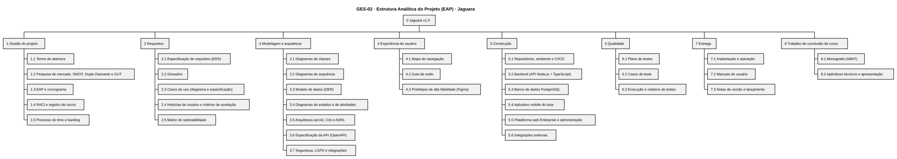

# GES-02 · Estrutura Analítica do Projeto (EAP)

| Campo | Valor |
|---|---|
| Projeto | Jaguara |
| Documento | GES-02 · Estrutura Analítica do Projeto e dicionário da EAP |
| Versão | 1.0 |
| Status | Em revisão |
| Autores | Ricardo Guilhen |
| Data | 01/11/2026 |
| Tarefa Jira | JAG-54 |
| Padrão de referência | PMBOK, Estrutura Analítica do Projeto (WBS) |

## Histórico de revisões

| Versão | Data | Autor | Descrição |
|---|---|---|---|
| 1.0 | 01/11/2026 | Ricardo Guilhen | Versão inicial a partir das entregas do TAP. |

## 1. Objetivo

Decompor as nove entregas do [Termo de Abertura (GES-01)](GES-01-TAP.md) em pacotes de trabalho mensuráveis, cada um ligado ao seu artefato e às tarefas do Jira.

## 2. Escopo

A EAP cobre todo o escopo da versão 1.0. Trabalho fora desta estrutura está fora do escopo do projeto. A decomposição chega ao nível de pacote de trabalho; as atividades de cada pacote vivem no Jira.

## 3. EAP

Fonte: [`eap/GES-02-EAP.puml`](eap/GES-02-EAP.puml)

### Relação com as entregas do TAP

| Entrega do TAP | Pacotes da EAP |
|---|---|
| 1. Definição da solução | 1.1, 1.2 |
| 2. Levantamento e documentação de requisitos | 2.1 a 2.5 |
| 3. Modelagem da solução | 3.1 a 3.7, 4.1 a 4.3 |
| 4. Funcionalidades do aplicativo mobile | 5.4 |
| 5. Funcionalidades da plataforma web | 5.5 |
| 6. Documentação do sistema | 1.3 a 1.5, 7.2, 8.2 |
| 7. Implementação das funções previstas | 5.1 a 5.3, 5.6 |
| 8. Testes e validação | 6.1 a 6.3 |
| 9. Entrega da versão 1.0 | 7.1, 7.3 |

## 4. Dicionário da EAP

| Código | Pacote de trabalho | Descrição | Artefato | Critério de aceite | Jira |
|---|---|---|---|---|---|
| 1.1 | Termo de abertura | Objetivo, escopo, premissas, restrições e critérios de sucesso | [GES-01](GES-01-TAP.md) | Aprovado pela equipe e pelo orientador | JAG-4 |
| 1.2 | Pesquisa de mercado e ferramentas | Domínios, INPI, CDC, LGPD, SWOT, Duplo Diamante e GUT | [GES-08](GES-08-pesquisa-de-mercado.md) | Entregue à disciplina de gestão | JAG-16, 18, 19, 20 |
| 1.3 | EAP e cronograma | Esta EAP e o cronograma com marcos | GES-02, [GES-03](GES-03-cronograma.md) | Todas as entregas do TAP decompostas e datadas | JAG-54, 55 |
| 1.4 | RACI e riscos | Responsabilidades e riscos com dono e resposta | [GES-04](GES-04-RACI.md), [GES-05](GES-05-registro-de-riscos.md) | Cada entrega com um aprovador; cada risco com dono | JAG-21, 56 |
| 1.5 | Processo e backlog | Cerimônias, fluxo do Jira, DoR, DoD e backlog | [GES-06](GES-06-processo-do-time.md), [GES-07](GES-07-backlog-documentacao.md) | Aprovado pelo time | JAG-34, 57 |
| 2.1 | ERS | Requisitos funcionais, regras de negócio e não funcionais mensuráveis | [REQ-01](../02-requisitos/REQ-01-ERS.md) | Estrutura ISO 29148; todo RNF com métrica | JAG-58, 59 |
| 2.2 | Glossário | Termos do domínio | [REQ-02](../02-requisitos/REQ-02-glossario.md) | Termos usados nos documentos definidos | JAG-60 |
| 2.3 | Casos de uso | Diagrama UML e especificação padronizada | [REQ-03](../02-requisitos/REQ-03-diagrama-casos-de-uso.md), [REQ-04](../02-requisitos/REQ-04-especificacao-casos-de-uso.md) | 46 casos de uso especificados e no diagrama | JAG-35, 61, 62 |
| 2.4 | Histórias de usuário | 46 histórias com critérios em Gherkin | [REQ-05](../02-requisitos/REQ-05-historias-de-usuario.md) | Cenário de sucesso e de exceção por história | JAG-63 |
| 2.5 | Rastreabilidade | RF ↔ RN ↔ UC ↔ US ↔ classes ↔ testes | [REQ-06](../02-requisitos/REQ-06-matriz-de-rastreabilidade.md) | Nenhum RF sem UC e sem teste | JAG-64 |
| 3.1 | Diagramas de classes | Modelo de domínio em UML | [MOD-01](../04-modelagem/MOD-01-modelo-de-classes.md) | Revisado pelo time | JAG-27 |
| 3.2 | Diagramas de sequência | Fluxos críticos | [MOD-02](../04-modelagem/MOD-02-diagramas-de-sequencia.md) | Seis fluxos coerentes com o MOD-01 | JAG-26 |
| 3.3 | Modelo de dados | DER lógico e físico, dicionário de dados | [MOD-03](../04-modelagem/MOD-03-modelo-de-dados.md) | Todas as classes persistentes mapeadas | JAG-47, 48 |
| 3.4 | Estados e atividades | Ciclos de vida e processos de negócio | [MOD-04](../04-modelagem/MOD-04-diagramas-de-estado.md), [MOD-05](../04-modelagem/MOD-05-diagramas-de-atividade.md) | Estados iguais às enumerações | JAG-66, 67 |
| 3.5 | Arquitetura e ADRs | arc42, C4 e decisões | [ARQ-01](../03-arquitetura/ARQ-01-arquitetura.md), [ADRs](../03-arquitetura/adr) | Decisões com alternativas e consequências | JAG-38, 39, 41, 44 |
| 3.6 | API | Contrato REST | [openapi.yaml](../03-arquitetura/api/openapi.yaml) | YAML válido; recursos dos UC da v1.0 | JAG-68 |
| 3.7 | Segurança e integrações | LGPD, controles de acesso, integrações externas | [ARQ-02](../03-arquitetura/ARQ-02-seguranca-e-lgpd.md), [ARQ-03](../03-arquitetura/ARQ-03-integracoes.md) | Bases legais e integrações especificadas | JAG-69, 70 |
| 4.1 | Mapa de navegação | Telas e fluxos | [UX-01](../06-ux/UX-01-mapa-de-navegacao.md) | Telas de todos os UC da v1.0 | JAG-71 |
| 4.2 | Guia de estilo | Cores, tipografia, componentes | [UX-02](../06-ux/UX-02-guia-de-estilo.md) | Contraste AA verificado | JAG-28 |
| 4.3 | Protótipos | Telas de alta fidelidade no Figma | [UX-03](../06-ux/UX-03-prototipos.md) | Export do Figma versionado | JAG-36, 83 |
| 5.1 | Repositórios e CI/CD | Repositórios, ambiente, esteira de deploy | README dos repositórios | Build e deploy automáticos | JAG-29, 31, 32, 33, 42, 45 |
| 5.2 a 5.6 | Construção | Backend, banco, mobile, web e integrações | Repositórios de código | Funcionalidades dos UC da v1.0 | Tarefas de desenvolvimento |
| 6.1 a 6.3 | Testes | Plano, casos e relatório | [TST-01](../05-testes/TST-01-plano-de-testes.md) a [TST-03](../05-testes/TST-03-relatorio-de-testes.md) | Critérios de saída do plano atendidos | JAG-43, 72, 73, 74 |
| 7.1 | Implantação | Deploy, backup e monitoramento | [ENT-01](../07-entrega/ENT-01-implantacao.md) | Deploy reproduzível | JAG-77 |
| 7.2 | Manuais | Tutor e Enterprise | [ENT-02](../07-entrega/ENT-02-manual-tutor.md), [ENT-03](../07-entrega/ENT-03-manual-enterprise.md) | Funções da v1.0 com passo a passo | JAG-78, 79 |
| 7.3 | Notas de versão | O que entra na v1.0 | [ENT-04](../07-entrega/ENT-04-notas-de-versao.md) | Limitações conhecidas registradas | JAG-80 |
| 8.1 | Monografia | Estrutura ABNT e mapa de capítulos | [TCC-01](../08-tcc/TCC-01-estrutura-monografia.md) | Sumário aprovado pelo orientador | JAG-81 |
| 8.2 | Apêndices | Documentos aprovados em PDF | [TCC-01](../08-tcc/TCC-01-estrutura-monografia.md) | Somente versões aprovadas | JAG-82 |
