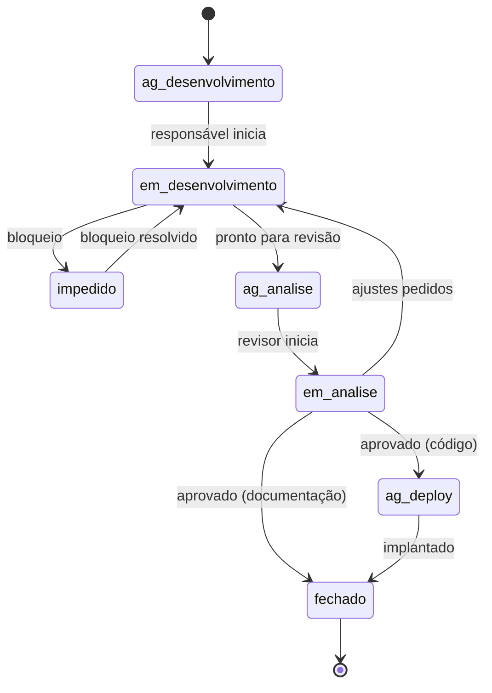

# GES-06 · Processo do time

| Campo | Valor |
|---|---|
| Projeto | Jaguara |
| Documento | GES-06 · Processo do time: cerimônias, fluxo de trabalho, DoR e DoD |
| Versão | 1.0 |
| Status | Em revisão |
| Autores | Ricardo Guilhen |
| Data | 01/11/2026 |
| Tarefa Jira | JAG-57 |
| Padrão de referência | Scrum Guide (2020) |

## Histórico de revisões

| Versão | Data | Autor | Descrição |
|---|---|---|---|
| 1.0 | 01/11/2026 | Ricardo Guilhen | Registro do processo praticado desde a Sprint 1 e das definições de pronto. |

## 1. Objetivo

Registrar como o time Jaguara planeja, executa e entrega trabalho, para que qualquer integrante saiba quando uma tarefa pode começar e quando ela está pronta. A justificativa das escolhas de processo de desenvolvimento (branches, CI e revisão) está na [ADR-008](../03-arquitetura/adr/ADR-008-processo-de-desenvolvimento.md).

## 2. Papéis

| Papel | Quem | Responsabilidade |
|---|---|---|
| *Product Owner* e gerente de projeto | Miguel Drozino | Prioriza o backlog, aceita as entregas e representa o produto junto aos orientadores |
| *Tech Lead* | A confirmar pelo time | Decisões técnicas, padrões de código e revisão técnica final |
| Time de desenvolvimento | Micaela Dorneles, Miguel Drozino, Nathan Rodrigues, Ricardo Guilhen | Planejam, executam e revisam as tarefas da sprint |

O time não tem Scrum Master dedicado; a facilitação das cerimônias é rotativa.

## 3. Sprints e cerimônias

| Cerimônia | Quando | Duração máxima | Saída |
|---|---|---|---|
| Planejamento da sprint | Quinta-feira de início da sprint | 1 h | Meta da sprint e tarefas na sprint do Jira |
| Alinhamento diário | Assíncrono, no grupo do time | — | Bloqueios registrados como status *impedido* |
| Revisão da sprint | Quinta-feira de fim da sprint | 30 min | Entregas demonstradas; tarefas não concluídas voltam ao backlog ou seguem para a próxima sprint |
| Retrospectiva | Logo após a revisão | 30 min | Uma ação de melhoria para a próxima sprint |
| Refinamento do backlog | Meio da sprint | 30 min | Tarefas da próxima sprint com DoR cumprida |

As sprints duram duas semanas, de quinta a quinta-feira, e são nomeadas "SCRUM Sprint N" no Jira.

## 4. Fluxo de trabalho no Jira

Projeto **JAG**, tipos de item **Tarefa** e **História**.

| Status | Significado |
|---|---|
| ag. desenvolvimento | No backlog ou na sprint, ainda não iniciada |
| em desenvolvimento | Em execução pelo responsável |
| impedido | Bloqueada por dependência externa ou decisão pendente |
| ag. analise | Concluída pelo responsável, aguardando revisão |
| em analise | Em revisão por outro integrante |
| ag. deploy | Código aprovado aguardando implantação |
| fechado | Pronto segundo a DoD |

## 5. Definition of Ready (DoR)

Uma tarefa entra na sprint quando:

- [ ] tem título no infinitivo e descrição com objetivo e entregável;
- [ ] tem critérios de aceite verificáveis;
- [ ] as dependências estão concluídas ou na mesma sprint;
- [ ] cabe em uma sprint (caso contrário, é dividida);
- [ ] o padrão de referência está indicado, quando for documentação.

## 6. Definition of Done (DoD)

Uma tarefa vai para *fechado* quando:

- [ ] todos os critérios de aceite foram atendidos;
- [ ] passou por revisão de outro integrante (pull request aprovado);
- [ ] **código:** build e testes automatizados passando na CI, cobertura das regras de negócio tocadas e implantado em homologação;
- [ ] **documentação:** cumpre a [DoD da documentação](../_modelos/DoD-documentacao.md);
- [ ] o link do pull request ou do documento está na tarefa.

## 7. Estimativa

O time não usa *story points*. O tempo estimado é registrado na descrição da tarefa durante o planejamento, e o tempo gasto é lançado no registro de trabalho do Jira.

## Questões em aberto

| ID | Questão | Encaminhamento |
|---|---|---|
| QA-01 | Quem exerce formalmente o papel de *Tech Lead* | Definir no planejamento da Sprint 7 e atualizar a seção 2 |
