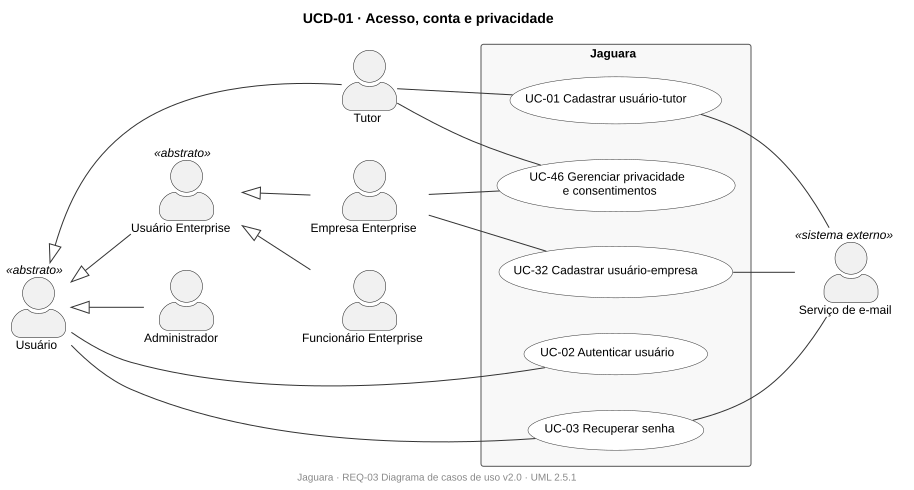
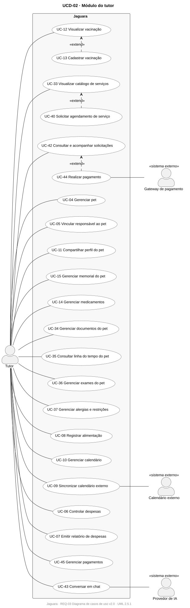
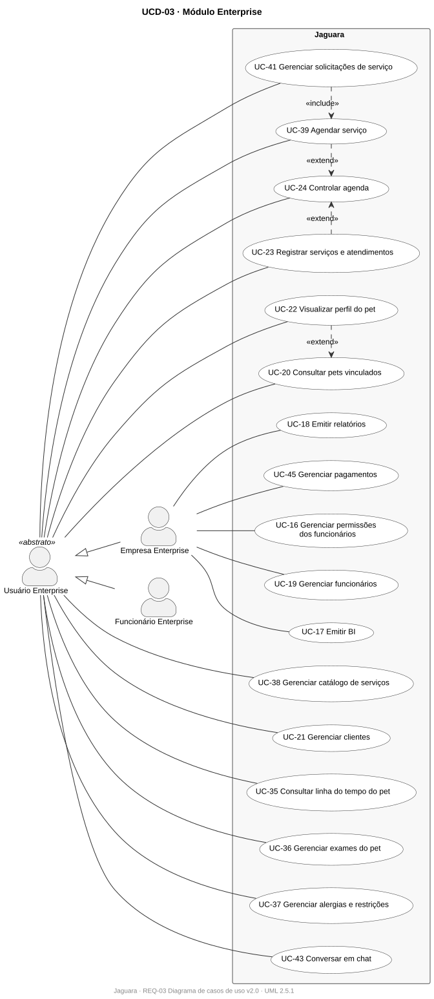
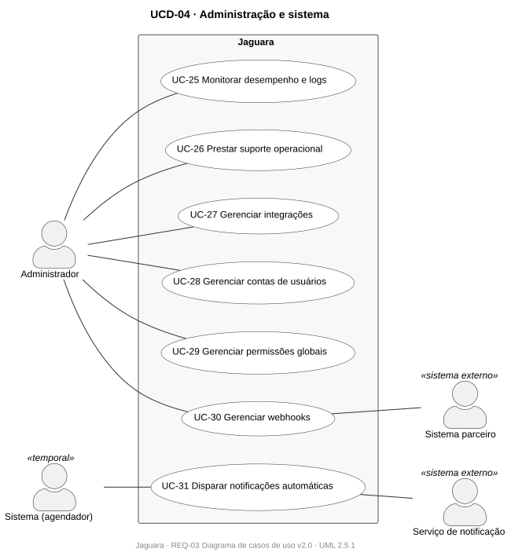

# REQ-03 · Diagrama de casos de uso

| Campo | Valor |
|---|---|
| Projeto | Jaguara |
| Documento | REQ-03 · Diagrama de casos de uso |
| Versão | 2.0 |
| Status | Em revisão |
| Autores | Miguel Drozino (versão 1), Ricardo Guilhen (versão 2) |
| Data | 01/11/2026 |
| Tarefa Jira | JAG-2 (versão 1), JAG-61 (adequação à UML) |
| Padrão de referência | UML 2.5.1, diagrama de casos de uso |
| Original | [REQ-03-diagrama-casos-de-uso-original.pdf](../anexos/originais/REQ-03-diagrama-casos-de-uso-original.pdf) |

## Histórico de revisões

| Versão | Data | Autor | Descrição |
|---|---|---|---|
| 1.0 | 01/11/2026 | Miguel Drozino | Diagrama único com os 46 casos de uso (JAG-2). |
| 2.0 | 01/11/2026 | Ricardo Guilhen | Adequação à notação UML 2.5.1 em PlantUML, dividida em quatro visões (JAG-61). |

## 1. Objetivo

Mostrar quem interage com o Jaguara e para quê: os atores, os 46 casos de uso e as relações entre eles. A especificação de cada caso de uso está no [REQ-04](REQ-04-especificacao-casos-de-uso.md).

## 2. Mudanças em relação à versão 1

| Versão 1 | Versão 2 (UML 2.5.1) | Motivo |
|---|---|---|
| Setas entre ator e caso de uso | Associação sem seta | Em UML a ligação ator–caso de uso é uma associação; a seta sugeriria navegabilidade ou fluxo de dados |
| Linhas repetidas de Empresa e Funcionário para os mesmos casos | Ator abstrato **Usuário Enterprise**, especializado por Empresa e Funcionário | Generalização de atores evita duplicação e deixa explícito o que é exclusivo da empresa |
| Linhas de todos os atores para Autenticar e Recuperar senha | Ator abstrato **Usuário**, especializado por Tutor, Usuário Enterprise e Administrador | Idem |
| Sem relações entre casos de uso | `<<include>>` e `<<extend>>` onde a especificação descreve reaproveitamento | Fluxos alternativos que levam a outro caso de uso viram extensões |
| Sem sistemas externos | Atores secundários (calendário, gateway, IA, e-mail, notificação, parceiro) | Torna visíveis as dependências externas do [ARQ-03](../03-arquitetura/ARQ-03-integracoes.md) |
| Um diagrama com 46 casos | Quatro visões por contexto | Legibilidade; cada visão cabe em uma página |

## 3. Atores

| Ator | Tipo | Descrição |
|---|---|---|
| Usuário | Abstrato | Qualquer conta autenticável |
| Tutor | Primário | Dono ou responsável por pets |
| Usuário Enterprise | Abstrato | Generaliza Empresa e Funcionário Enterprise |
| Empresa Enterprise | Primário | Conta da empresa; casos exclusivos: permissões, funcionários, BI, relatórios e pagamentos recebidos |
| Funcionário Enterprise | Primário | Usuário vinculado à empresa, com acesso conforme perfil (RN20) |
| Administrador | Primário | Operador da plataforma |
| Sistema (agendador) | Temporal | Dispara as notificações programadas |
| Calendário externo, Gateway de pagamento, Provedor de IA, Serviço de e-mail, Serviço de notificação, Sistema parceiro | Secundários | Sistemas externos ([ARQ-03](../03-arquitetura/ARQ-03-integracoes.md)) |

## 4. Diagramas

### 4.1 UCD-01 · Acesso, conta e privacidade

### 4.2 UCD-02 · Módulo do tutor

### 4.3 UCD-03 · Módulo Enterprise

### 4.4 UCD-04 · Administração e sistema

Fontes: [`casos-de-uso/`](casos-de-uso).

## 5. Relações entre casos de uso

| Relação | Origem | Destino | Justificativa na especificação |
|---|---|---|---|
| `<<extend>>` | UC-13 Cadastrar vacinação | UC-12 Visualizar vacinação | Cadastro iniciado a partir do histórico vacinal |
| `<<extend>>` | UC-40 Solicitar agendamento | UC-33 Visualizar catálogo | O catálogo oferece a opção de agendar (UC-33, passo 4) |
| `<<extend>>` | UC-44 Realizar pagamento | UC-42 Consultar solicitações | Pagamento de solicitação aceita |
| `<<include>>` | UC-41 Gerenciar solicitações | UC-39 Agendar serviço | Aceitar uma solicitação cria o agendamento (RN40) |
| `<<extend>>` | UC-39 Agendar serviço | UC-24 Controlar agenda | "Agendar novo horário" a partir da agenda (UC-24, FA01) |
| `<<extend>>` | UC-23 Registrar atendimento | UC-24 Controlar agenda | Registro a partir de agendamento ocorrido (UC-24, passo 6) |
| `<<extend>>` | UC-22 Visualizar perfil do pet | UC-20 Consultar pets vinculados | Perfil aberto a partir da lista (UC-22, passo 1) |

A autenticação (UC-02) é pré-condição dos demais casos de uso e por isso não aparece como `<<include>>`.

## 6. Cobertura

Os 46 casos de uso do [REQ-04](REQ-04-especificacao-casos-de-uso.md) aparecem em pelo menos uma visão. UC-35, UC-36, UC-37, UC-43 e UC-45 aparecem nas visões do tutor e da Enterprise porque são compartilhados.
