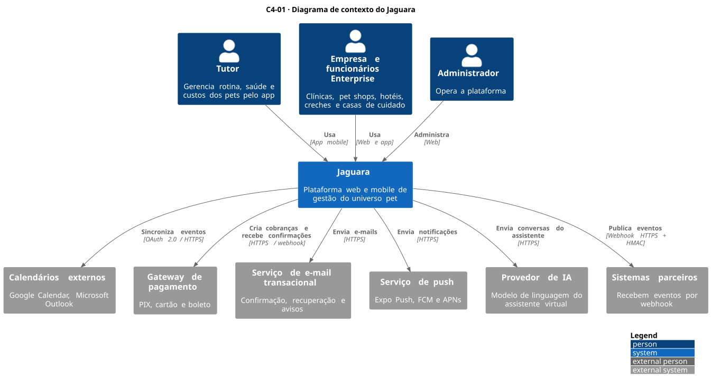
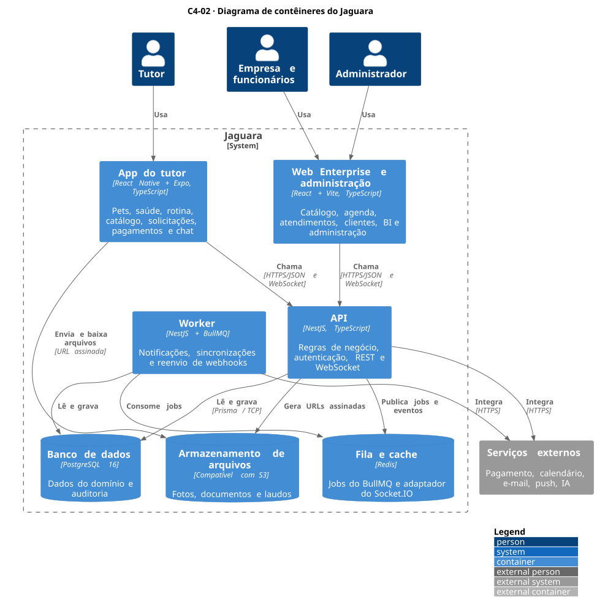
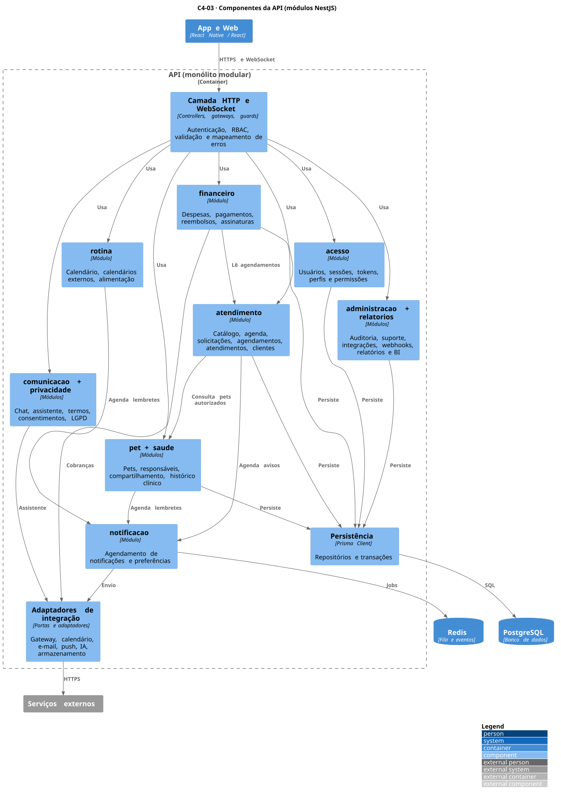
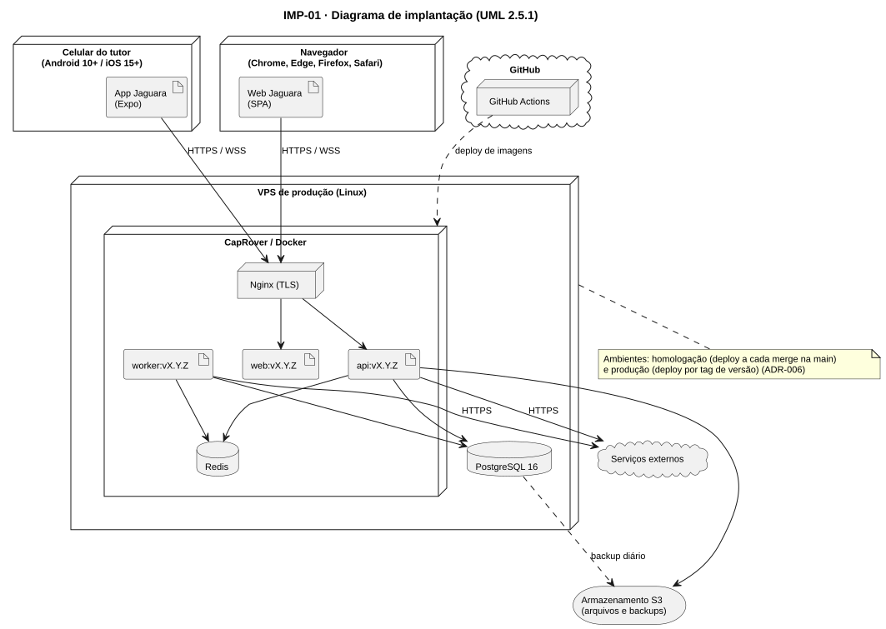

# ARQ-01 · Documentação de arquitetura

| Campo | Valor |
|---|---|
| Projeto | Jaguara |
| Documento | ARQ-01 · Documentação de arquitetura de software |
| Versão | 1.0 |
| Status | Em revisão |
| Autores | Ricardo Guilhen |
| Data | 01/11/2026 |
| Tarefa Jira | JAG-41, JAG-44 |
| Padrão de referência | arc42 (versão 8), diagramas C4 e UML 2.5.1 (implantação) |

## Histórico de revisões

| Versão | Data | Autor | Descrição |
|---|---|---|---|
| 1.0 | 01/11/2026 | Ricardo Guilhen | Primeira versão nas 12 seções do arc42, com C4 de contexto, contêineres e componentes. |

## 1. Introdução e objetivos

### 1.1 Requisitos principais

O Jaguara centraliza a rotina, a saúde e os custos dos pets para tutores (app mobile) e a operação de empresas do setor pet (web Enterprise), integrando os dois lados por solicitações, agendamentos, atendimentos, compartilhamento de dados e pagamentos. Requisitos completos no [REQ-01](../02-requisitos/REQ-01-ERS.md).

### 1.2 Metas de qualidade

| Prioridade | Meta | RNF | Motivação |
|---|---|---|---|
| 1 | Segurança e privacidade | RNF01 | Dados pessoais de tutores e dados de saúde dos pets (LGPD, risco R03) |
| 2 | Manutenibilidade | RNF09 | Time pequeno, prazo acadêmico e evolução contínua do escopo |
| 3 | Confiabilidade | RNF02, RNF07 | Lembretes de medicamento e agendamentos não podem se perder |
| 4 | Usabilidade | RNF06 | Público com pouca familiaridade tecnológica (SWOT) |
| 5 | Desempenho e tempo real | RNF03, RNF08 | Agenda e chat compartilhados entre dispositivos |

### 1.3 Partes interessadas

| Parte | Expectativa em relação à arquitetura |
|---|---|
| Equipe de desenvolvimento | Estrutura simples de entender, uma só linguagem e ambiente local reproduzível |
| Tutores e empresas | Aplicativo rápido, disponível e seguro |
| Orientadores | Decisões justificadas e documentadas (ADRs) |
| Veterinários parceiros | Dados clínicos íntegros e acesso apenas com autorização do tutor |

## 2. Restrições

| Restrição | Origem |
|---|---|
| TypeScript como linguagem principal | Time ([ADR-004](adr/ADR-004-stack-backend.md)) |
| PostgreSQL como banco relacional | Duplo Diamante ([ADR-005](adr/ADR-005-banco-de-dados.md)) |
| Arquitetura cliente-servidor por API | [ADR-001](adr/ADR-001-arquitetura-cliente-servidor.md) |
| Contextos Tutor e Enterprise separados com RBAC | [ADR-002](adr/ADR-002-separacao-tutor-enterprise.md) |
| Orçamento de infraestrutura reduzido | Risco R07 |
| Conformidade com LGPD e CDC | [GES-08](../01-gestao/GES-08-pesquisa-de-mercado.md) |
| Prazo do calendário acadêmico | [GES-03](../01-gestao/GES-03-cronograma.md) |

## 3. Contexto e escopo



| Vizinho | Entrada | Saída |
|---|---|---|
| Tutor (app) | Cadastros, registros de saúde e rotina, solicitações, pagamentos, mensagens | Lembretes, status de solicitações, histórico |
| Empresa e funcionários (web) | Catálogo, agenda, aceites, atendimentos, clientes | Solicitações, agenda, relatórios, BI |
| Administrador (web) | Status de contas, permissões, integrações, webhooks | Logs, métricas, chamados |
| Calendários externos | Eventos autorizados | Eventos do pet |
| Gateway de pagamento | Confirmações de pagamento (webhook) | Cobranças e estornos |
| E-mail e *push* | — | Mensagens transacionais e lembretes |
| Provedor de IA | Respostas do assistente | Contexto da conversa, sem dados identificáveis desnecessários |
| Sistemas parceiros | — | Eventos assinados (webhooks) |

## 4. Estratégia de solução

| Problema | Solução | Decisão |
|---|---|---|
| Dois públicos, um domínio | API única com módulos por contexto e RBAC | ADR-001, ADR-002 |
| Time pequeno e prazo curto | Monólito modular em NestJS, TypeScript em todas as camadas | ADR-004, ADR-007 |
| Integridade de agenda e pagamentos | Regras no banco (restrições de exclusão e `CHECK`) além do domínio | ADR-005, [MOD-03](../04-modelagem/MOD-03-modelo-de-dados.md) |
| Lembretes e integrações fora da requisição | Filas BullMQ e *worker* separado | ADR-011 |
| Tempo real | WebSocket (Socket.IO) | ADR-011 |
| Custo | Contêineres em VPS com CapRover | ADR-006 |
| Dependências externas | Portas e adaptadores por integração | [ARQ-03](ARQ-03-integracoes.md) |

## 5. Visão de blocos

### 5.1 Nível 2: contêineres



| Contêiner | Responsabilidade | Tecnologia |
|---|---|---|
| App do tutor | Interface do tutor | React Native + Expo |
| Web Enterprise e administração | Interface da empresa, dos funcionários e do administrador | React + Vite |
| API | Regras de negócio, autenticação, REST ([OpenAPI](api/openapi.yaml)) e WebSocket | NestJS |
| Worker | Jobs assíncronos | NestJS + BullMQ |
| PostgreSQL | Dados e auditoria | PostgreSQL 16 |
| Redis | Filas e eventos | Redis 7 |
| Armazenamento de arquivos | Documentos, laudos e fotos | Compatível com S3 |

### 5.2 Nível 3: componentes da API



Cada módulo corresponde a um pacote do [MOD-01](../04-modelagem/MOD-01-modelo-de-classes.md) e é dividido em camadas:

| Camada | Conteúdo | Regra de dependência |
|---|---|---|
| `http` | Controllers, DTOs, *guards*, *gateways* WebSocket | Depende de `aplicacao` |
| `aplicacao` | Serviços de caso de uso (ex.: `SolicitacaoService.aceitar`) e transações | Depende de `dominio` e das portas |
| `dominio` | Entidades, enumerações e regras (ex.: `Agendamento.verificarConflitos`) | Não depende de framework |
| `infra` | Repositórios Prisma e adaptadores externos | Implementa as portas |

Estrutura de pastas do backend:

```text
src/
  modulos/
    acesso/        http/ aplicacao/ dominio/ infra/
    pet/           ...
    saude/
    rotina/
    notificacao/
    atendimento/
    financeiro/
    comunicacao/
    privacidade/
    administracao/
    relatorios/
  compartilhado/   auth, erros, auditoria, prisma, config
  worker.ts        processadores BullMQ
  main.ts
prisma/schema.prisma
test/              testes de API (Jest + Supertest)
```

## 6. Visão de execução

Os cenários críticos estão no [MOD-02](../04-modelagem/MOD-02-diagramas-de-sequencia.md):

| Cenário | Diagrama |
|---|---|
| Login com bloqueio e expiração de sessão | DS-01 |
| Tutor solicita agendamento | DS-02 |
| Empresa aceita solicitação e cria agendamento | DS-03 |
| Registro e alteração auditada de atendimento | DS-04 |
| Pagamento com confirmação por webhook | DS-05 |
| Agendamento e disparo de notificações | DS-06 |

## 7. Visão de implantação



| Ambiente | Gatilho | Infraestrutura |
|---|---|---|
| Local | `docker compose up` | API, worker, PostgreSQL e Redis em contêineres |
| Homologação | Merge na `main` | VPS com CapRover, banco de homologação |
| Produção | *Tag* `vX.Y.Z` | VPS com CapRover, banco de produção com backup diário |
| App mobile | Expo EAS | Builds de teste (homologação) e de loja (produção) |

Procedimentos no [ENT-01](../07-entrega/ENT-01-implantacao.md).

## 8. Conceitos transversais

| Conceito | Abordagem |
|---|---|
| Autenticação e autorização | JWT de curta duração e sessão revogável; RBAC por rota e verificação de posse ou compartilhamento no serviço ([ADR-009](adr/ADR-009-autenticacao-e-autorizacao.md)) |
| Privacidade | Minimização de dados, consentimentos versionados, exportação e exclusão a pedido do titular ([ARQ-02](ARQ-02-seguranca-e-lgpd.md)) |
| Validação | DTOs validados na entrada; regras de domínio nas entidades; restrições no banco |
| Erros | Formato único `application/problem+json` (RFC 9457) com código de negócio ([OpenAPI](api/openapi.yaml)) |
| Auditoria | `LogAuditoria` para ações críticas (RN28, RN31, RN32, RN34) |
| Transações | Casos de uso que alteram mais de um agregado rodam em uma transação Prisma |
| Datas | Armazenadas em UTC (`timestamptz`), exibidas no fuso do usuário (padrão America/Sao_Paulo) |
| Observabilidade | Logs estruturados em JSON com identificador de requisição; *health check* `/health`; métricas de latência |
| Configuração | Variáveis de ambiente validadas na inicialização; segredos fora do repositório |
| Testes | Unitários no domínio, de API por caso de uso e de ponta a ponta nos fluxos críticos ([TST-01](../05-testes/TST-01-plano-de-testes.md)) |
| Idioma | Interface em português do Brasil; código e identificadores do domínio em português, sem acentos |

## 9. Decisões de arquitetura

O registro completo está em [adr/](adr/README.md).

| ADR | Decisão | Status |
|---|---|---|
| ADR-001 | Arquitetura cliente-servidor baseada em API | Aceita |
| ADR-002 | Separação dos contextos Tutor e Enterprise | Aceita |
| ADR-003 | Padrão de documentação | Aceita |
| ADR-004 | TypeScript, NestJS, monólito modular e Prisma | Proposta |
| ADR-005 | PostgreSQL 16 | Aceita |
| ADR-006 | Contêineres em VPS com CapRover | Proposta |
| ADR-007 | React Native com Expo e React com Vite | Proposta |
| ADR-008 | GitHub Flow, pull request, CI e DoD | Proposta |
| ADR-009 | Autenticação própria com JWT e sessão revogável | Proposta |
| ADR-010 | Chat em dois modos, plano PANTERA e cliente como tutor | Aceita (itens 1 e 2) |
| ADR-011 | WebSocket e filas BullMQ | Proposta |

## 10. Requisitos de qualidade

| RNF | Cenário de qualidade | Resposta da arquitetura |
|---|---|---|
| RNF01 | Funcionário removido tenta usar um token ainda válido | Sessão revogada no banco; o *guard* consulta a sessão e responde 401 (RN23) |
| RNF02 | Queda da instância da API | CapRover reinicia o contêiner; *health check* externo alerta o time |
| RNF03 | 100 usuários abrem a agenda ao mesmo tempo | Índices por data e empresa; paginação; p95 medido com k6 |
| RNF04 | Tutor usa um Android 10 | Expo SDK com suporte ao Android 10; matriz de testes |
| RNF05 | Base cresce para 10.000 tutores | API sem estado, réplicas adicionais atrás do Nginx; Redis compartilhado |
| RNF06 | Tutor com pouca experiência registra uma vacina | Fluxo em até 3 toques ([UX-01](../06-ux/UX-01-mapa-de-navegacao.md)) |
| RNF07 | Perda do servidor de banco | Restauração do backup diário em até 4 h |
| RNF08 | Empresa aceita a solicitação | Evento WebSocket atualiza o app do tutor em até 2 s |
| RNF09 | Nova funcionalidade no módulo financeiro | Mudança restrita ao módulo, coberta por testes na CI |
| RNF10 | Troca do gateway de pagamento | Novo adaptador implementando a mesma porta |

## 11. Riscos e débitos técnicos

| Risco | Tratamento |
|---|---|
| Dependência de serviços externos (R10) | Adaptadores, *sandbox* e reprocessamento por filas |
| Operar a própria VPS | Automação pelo CapRover e checklist de operação no ENT-01 |
| ADRs ainda em "Proposta" | Confirmar na discussão de ADRs (JAG-39) antes do primeiro release |
| Assistente virtual pode dar orientação clínica | Aviso fixo e instruções do sistema que proíbem diagnóstico (risco R08) |

## 12. Glossário

Ver [REQ-02](../02-requisitos/REQ-02-glossario.md).
