# MOD-01 · Modelo de Classes do Jaguara

| Campo | Valor |
|---|---|
| Projeto | Jaguara |
| Documento | MOD-01 · Modelo de Classes |
| Versão | 1.0 |
| Status | Em revisão |
| Autores | Micaela Dorneles, Miguel Drozino, Nathan Rodrigues, Ricardo Guilhen |
| Data | 28/10/2026 |
| Notação | UML 2.5.1 (OMG), diagramas em PlantUML |

## Histórico de revisões

| Versão | Data | Autor | Descrição |
|---|---|---|---|
| 1.0 | 28/10/2026 | Equipe Jaguara | Versão inicial em UML 2.5.1. Substitui o rascunho em Mermaid. Pacotes rotina/notificacao e atendimento mostrados em duas visões cada. |

## 1. Objetivo

Descrever a estrutura estática do domínio do Jaguara: classes, atributos, operações, relacionamentos e restrições, com rastreabilidade para os requisitos funcionais e as regras de negócio.

## 2. Escopo

Este documento é o **diagrama de classes de projeto** da camada de domínio, para o app mobile do tutor e a plataforma web Enterprise. Ficam fora dele:

- identificadores técnicos e chaves estrangeiras, que pertencem ao modelo de dados (MOD-03 · Modelo ER);
- classes de interface, controladores e infraestrutura, que pertencem à documentação de arquitetura (ARQ-01);
- métricas de desempenho do RF26, que vêm da ferramenta de monitoramento.

## 3. Referências

| ID | Documento |
|---|---|
| REF-01 | TAP · Termo de Abertura do Projeto Jaguara |
| REF-02 | Documento de requisitos e regras de negócio (RF01–RF45, RN01–RN40, RNF01–RNF10) |
| REF-03 | Especificação de casos de uso JGR001–JGR047 |
| REF-04 | OMG Unified Modeling Language (UML) 2.5.1 |
| REF-05 | OMG Object Constraint Language (OCL) 2.4 |

## 4. Convenções

### 4.1 Notação

| Elemento | Notação | Significado |
|---|---|---|
| Visibilidade | `-` privado, `+` público | Atributos são privados; operações são públicas. |
| Multiplicidade de atributo | `[0..1]`, `[1..*]` | Sem indicação, a multiplicidade é 1 (obrigatório). |
| Atributo derivado | `/nome` | Calculado a partir de outros atributos. |
| Restrição | `{unique}`, `{readOnly}`, `{ordered}`, `{xor}` | Restrições UML no próprio elemento. |
| Classe abstrata | Nome em itálico | Não é instanciada diretamente. |
| Generalização | Linha com triângulo vazado | Herança (é um). |
| Realização | Tracejado com triângulo vazado | A classe implementa a interface. |
| Composição | Losango cheio | A parte não existe sem o todo. |
| Associação navegável | Seta aberta | A classe de origem conhece a de destino. |
| Classe de associação | Classe ligada por tracejado a uma associação | Atributos do próprio vínculo. |
| Pontas de associação | `papel multiplicidade` | Nome do papel seguido da multiplicidade. |
| Classe de outro pacote | Caixa cinza com nome qualificado (`acesso::Tutor`) | Detalhada no diagrama do seu pacote. |

### 4.2 Tipos de dados

Tipos primitivos da UML: `String`, `Integer`, `Boolean`, `Real`. Tipos de dados do projeto: `Date`, `DateTime`, `Time`, `Decimal` (valores monetários, duas casas) e `Byte`. Objetos de valor usam o estereótipo `«dataType»` (ex.: `Endereco`).

### 4.3 Nomenclatura

- Classes, interfaces e enumerações em `PascalCase`, no singular, em português sem acento.
- Atributos, operações e papéis em `camelCase`.
- Valores de enumeração em `CAIXA_ALTA`.
- Pacotes em minúsculas.

### 4.4 Identificadores

Diagramas: `DC-nn`. Restrições de integridade: `RC-nn`. Questões em aberto: `QA-nn`. Requisitos e regras seguem a numeração do REF-02.

## 5. Organização em pacotes

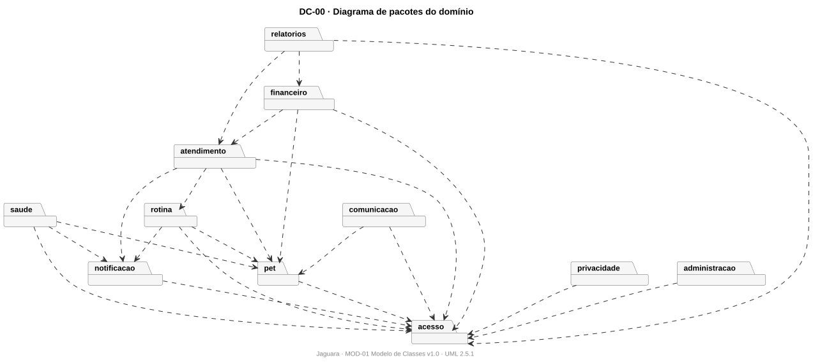

| Pacote | Responsabilidade | Classes |
|---|---|---|
| `acesso` | Identidade, autenticação, sessões e controle de acesso. | `Usuario`, `Tutor`, `Administrador`, `EmpresaEnterprise`, `FuncionarioEnterprise`, `Endereco`, `Sessao`, `TokenAcesso`, `HistoricoSenha`, `PerfilAcesso`, `Permissao` |
| `pet` | Cadastro do pet, responsáveis, compartilhamento, documentos, alergias e memorial. | `Pet`, `Especie`, `Raca`, `ResponsavelPet`, `CompartilhamentoPet`, `Memorial`, `ItemMemorial`, `DocumentoPet`, `AlergiaRestricao` |
| `saude` | Histórico clínico: vacinação, exames e tratamentos. | `RegistroClinico`, `Vacinacao`, `Exame`, `TratamentoMedicamentoso` |
| `rotina` | Calendário, integração com calendários externos e alimentação. | `EventoCalendario`, `CalendarioExterno`, `PlanoAlimentar`, `RegistroAlimentacao` |
| `notificacao` | Lembretes automáticos e preferências de envio. | `Notificavel`, `Notificacao`, `ConfiguracaoNotificacao` |
| `atendimento` | Operação das empresas: clientes, catálogo, agenda, solicitações e atendimentos. | `Cliente`, `Servico`, `Recurso`, `HorarioAtuacao`, `SolicitacaoServico`, `HistoricoSolicitacao`, `Agendamento`, `Atendimento`, `ItemAtendimento` |
| `financeiro` | Despesas, pagamentos, reembolsos e assinaturas. | `CategoriaDespesa`, `Despesa`, `Pagamento`, `SolicitacaoReembolso`, `Assinatura` |
| `comunicacao` | Chat da plataforma. | `Conversa`, `Mensagem` |
| `privacidade` | Termos, consentimentos e direitos do titular (LGPD). | `TermoUso`, `Consentimento`, `SolicitacaoPrivacidade` |
| `administracao` | Auditoria, suporte, integrações e webhooks. | `LogAuditoria`, `ChamadoSuporte`, `IntervencaoSuporte`, `Integracao`, `Webhook` |
| `relatorios` | Relatórios do tutor e da empresa. | `Relatorio` |

## 6. Diagramas por pacote

### 6.1 DC-01 · Acesso

Usuários, autenticação e perfis de acesso. Os quatro atores herdam de `Usuario` (generalização {complete, disjoint}).

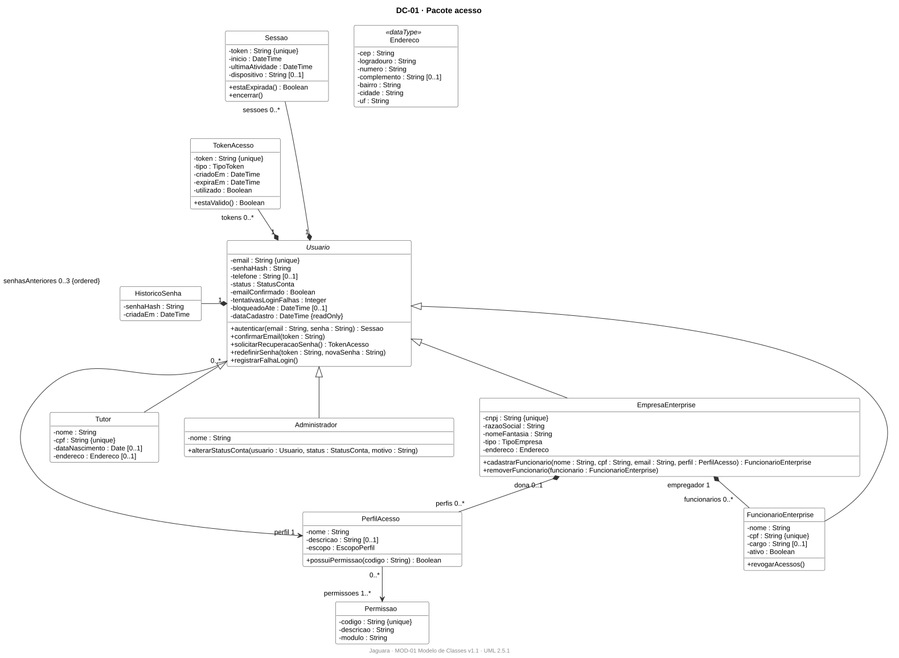

Fonte: [`DC-01-acesso.puml`](diagrama-de-classes/DC-01-acesso.puml)

### 6.2 DC-02 · Pet e saude

O pet, seus responsáveis (classe de associação `ResponsavelPet`), compartilhamento com terceiros e o histórico clínico, que reúne vacinação, exame e tratamento sob `RegistroClinico`.

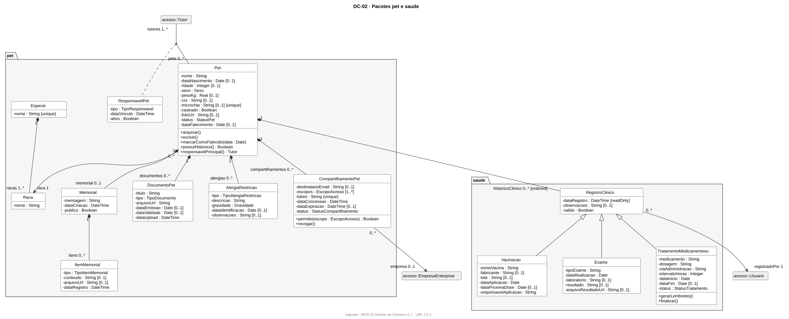

Fonte: [`DC-02-pet-e-saude.puml`](diagrama-de-classes/DC-02-pet-e-saude.puml)

### 6.3 DC-03a · Rotina

Calendário do pet, integração com calendários externos e alimentação.

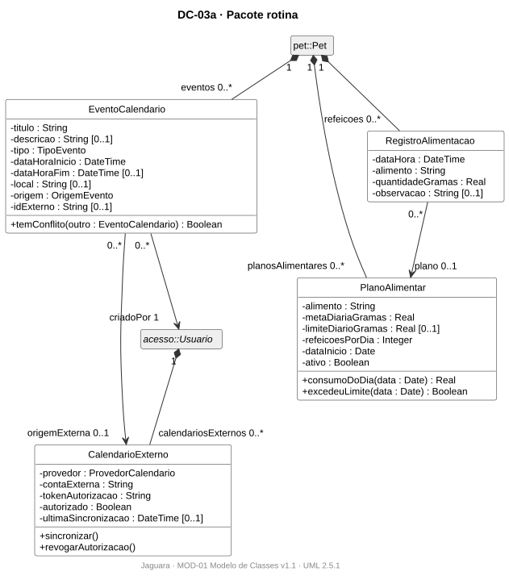

Fonte: [`DC-03a-rotina.puml`](diagrama-de-classes/DC-03a-rotina.puml)

### 6.4 DC-03b · Notificacao

Notificações automáticas. Toda classe que gera lembrete realiza a interface `Notificavel`, de outros pacotes.

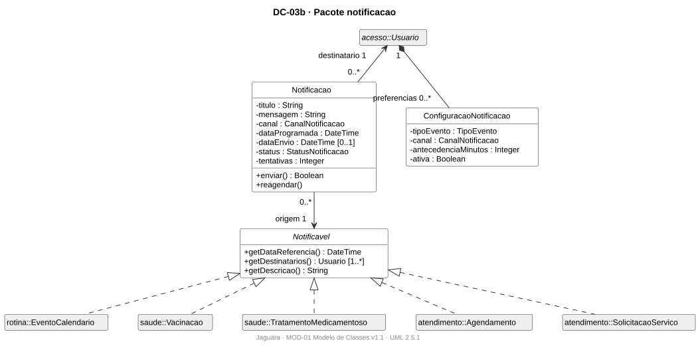

Fonte: [`DC-03b-notificacao.puml`](diagrama-de-classes/DC-03b-notificacao.puml)

### 6.5 DC-04a · Catalogo e agenda

Primeira visão do pacote atendimento: clientes (classe de associação entre empresa e tutor), catálogo de serviços, recursos e horários de atuação.

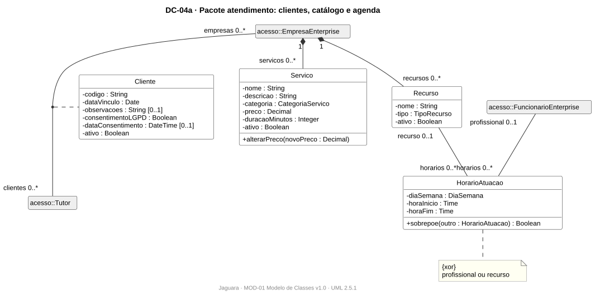

Fonte: [`DC-04a-catalogo-e-agenda.puml`](diagrama-de-classes/DC-04a-catalogo-e-agenda.puml)

### 6.6 DC-04b · Solicitacao e atendimento

Segunda visão do pacote atendimento: o fluxo SolicitacaoServico → Agendamento → Atendimento. `Servico` e `Recurso` aparecem sem compartimentos porque estão detalhados no DC-04a.

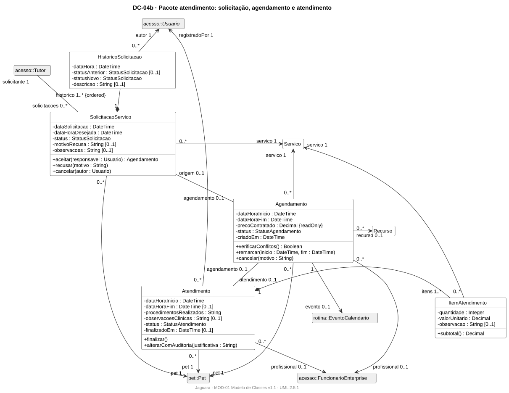

Fonte: [`DC-04b-solicitacao-e-atendimento.puml`](diagrama-de-classes/DC-04b-solicitacao-e-atendimento.puml)

### 6.7 DC-05 · Financeiro

Despesas do tutor, pagamentos de serviços e assinaturas, e reembolsos.

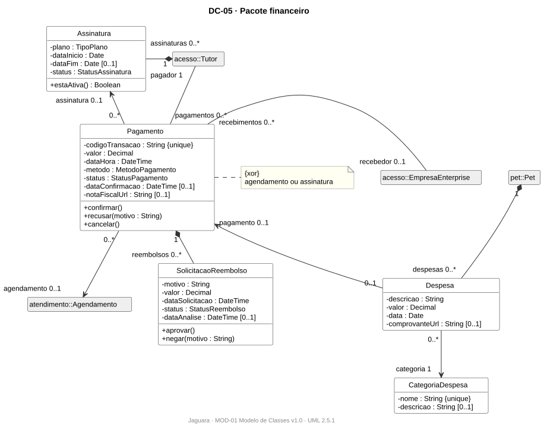

Fonte: [`DC-05-financeiro.puml`](diagrama-de-classes/DC-05-financeiro.puml)

### 6.8 DC-06 · Comunicacao e privacidade

Chat entre tutor e empresa ou assistente virtual, e controle de consentimentos e solicitações de titulares (LGPD).

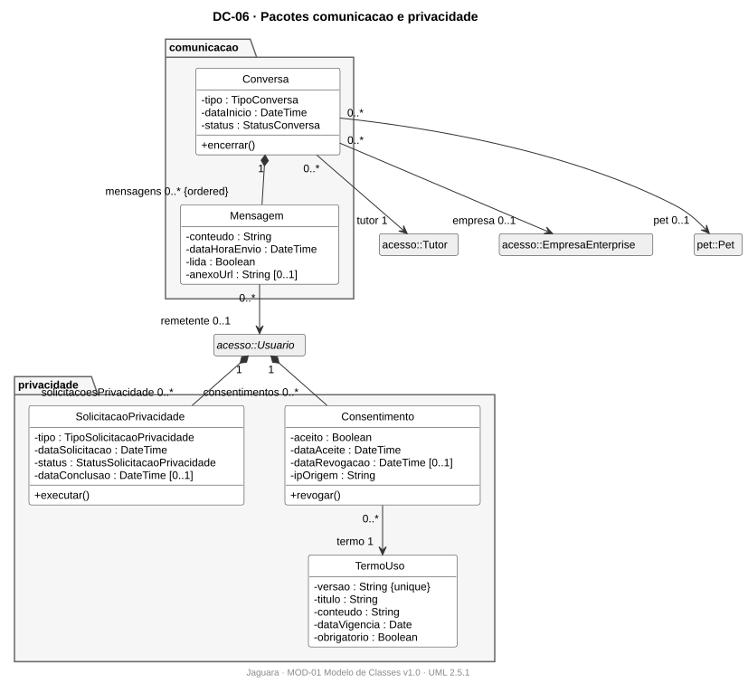

Fonte: [`DC-06-comunicacao-e-privacidade.puml`](diagrama-de-classes/DC-06-comunicacao-e-privacidade.puml)

### 6.9 DC-07 · Administracao e relatorios

Auditoria, suporte, integrações, webhooks e relatórios.

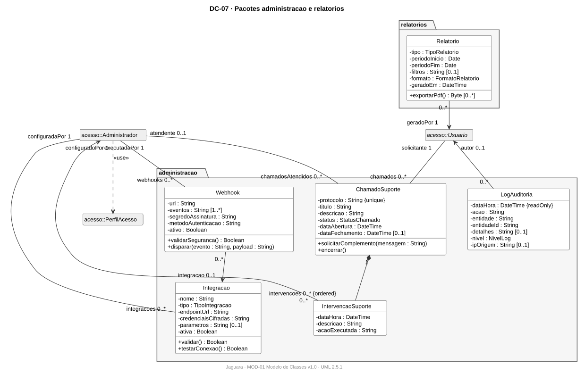

Fonte: [`DC-07-administracao-e-relatorios.puml`](diagrama-de-classes/DC-07-administracao-e-relatorios.puml)

## 7. Dicionário de classes

### 7.1 Pacote `acesso`

#### Usuario (classe abstrata)

Conta de acesso à plataforma. Abstrata: toda conta é de um dos quatro tipos de ator.

| Atributo | Tipo | Mult. | Restrição | Descrição |
|---|---|---|---|---|
| `email` | `String` | 1 | `{unique}` | E-mail de login e contato |
| `senhaHash` | `String` | 1 |  | Hash da senha (nunca a senha em texto) |
| `telefone` | `String` | 0..1 |  | Telefone de contato |
| `status` | `StatusConta` | 1 |  | Situação atual |
| `emailConfirmado` | `Boolean` | 1 |  | Indica se o e-mail foi confirmado |
| `tentativasLoginFalhas` | `Integer` | 1 |  | Falhas de login consecutivas |
| `bloqueadoAte` | `DateTime` | 0..1 |  | Fim do bloqueio temporário de login |
| `dataCadastro` | `DateTime` | 1 | `{readOnly}` | Data de criação da conta |

Operações:

- `autenticar(email : String, senha : String) : Sessao`
- `confirmarEmail(token : String)`
- `solicitarRecuperacaoSenha() : TokenAcesso`
- `redefinirSenha(token : String, novaSenha : String)`
- `registrarFalhaLogin()`

#### Tutor (classe)

Dono ou responsável por pets. Ator principal do aplicativo mobile.

| Atributo | Tipo | Mult. | Restrição | Descrição |
|---|---|---|---|---|
| `nome` | `String` | 1 |  | Nome |
| `cpf` | `String` | 1 | `{unique}` | CPF |
| `dataNascimento` | `Date` | 0..1 |  | Data de nascimento |
| `endereco` | `Endereco` | 0..1 |  | Endereço |

#### Administrador (classe)

Operador da plataforma: suporte, contas, permissões globais e integrações.

| Atributo | Tipo | Mult. | Restrição | Descrição |
|---|---|---|---|---|
| `nome` | `String` | 1 |  | Nome |

Operações:

- `alterarStatusConta(usuario : Usuario, status : StatusConta, motivo : String)`

#### EmpresaEnterprise (classe)

Clínica, pet shop, hotel, creche ou casa de cuidado que usa o módulo Enterprise.

| Atributo | Tipo | Mult. | Restrição | Descrição |
|---|---|---|---|---|
| `cnpj` | `String` | 1 | `{unique}` | CNPJ |
| `razaoSocial` | `String` | 1 |  | Razão social |
| `nomeFantasia` | `String` | 1 |  | Nome fantasia |
| `tipo` | `TipoEmpresa` | 1 |  | Classificação |
| `endereco` | `Endereco` | 1 |  | Endereço |

Operações:

- `cadastrarFuncionario(nome : String, cpf : String, email : String, perfil : PerfilAcesso) : FuncionarioEnterprise`
- `removerFuncionario(funcionario : FuncionarioEnterprise)`

#### FuncionarioEnterprise (classe)

Usuário vinculado a uma empresa, com acesso definido pelo perfil que a empresa atribui.

| Atributo | Tipo | Mult. | Restrição | Descrição |
|---|---|---|---|---|
| `nome` | `String` | 1 |  | Nome |
| `cpf` | `String` | 1 | `{unique}` | CPF |
| `cargo` | `String` | 0..1 |  | Cargo na empresa |
| `ativo` | `Boolean` | 1 |  | Indica se está ativo |

Operações:

- `revogarAcessos()`

#### Endereco («dataType»)

Tipo de dado (objeto de valor) para endereço postal.

| Atributo | Tipo | Mult. | Restrição | Descrição |
|---|---|---|---|---|
| `cep` | `String` | 1 |  | CEP |
| `logradouro` | `String` | 1 |  | Logradouro |
| `numero` | `String` | 1 |  | Número |
| `complemento` | `String` | 0..1 |  | Complemento |
| `bairro` | `String` | 1 |  | Bairro |
| `cidade` | `String` | 1 |  | Cidade |
| `uf` | `String` | 1 |  | Sigla do estado |

#### Sessao (classe)

Sessão autenticada de um usuário em um dispositivo.

| Atributo | Tipo | Mult. | Restrição | Descrição |
|---|---|---|---|---|
| `token` | `String` | 1 | `{unique}` | Valor aleatório de identificação |
| `inicio` | `DateTime` | 1 |  | Início da sessão |
| `ultimaAtividade` | `DateTime` | 1 |  | Última requisição da sessão |
| `dispositivo` | `String` | 0..1 |  | Dispositivo de origem |

Operações:

- `estaExpirada() : Boolean`
- `encerrar()`

#### TokenAcesso (classe)

Token de uso único para confirmar e-mail ou redefinir senha.

| Atributo | Tipo | Mult. | Restrição | Descrição |
|---|---|---|---|---|
| `token` | `String` | 1 | `{unique}` | Valor aleatório de identificação |
| `tipo` | `TipoToken` | 1 |  | Classificação |
| `criadoEm` | `DateTime` | 1 |  | Momento de criação |
| `expiraEm` | `DateTime` | 1 |  | Momento de expiração |
| `utilizado` | `Boolean` | 1 |  | Indica se já foi usado |

Operações:

- `estaValido() : Boolean`

#### HistoricoSenha (classe)

Hash das senhas anteriores, usado para impedir reutilização.

| Atributo | Tipo | Mult. | Restrição | Descrição |
|---|---|---|---|---|
| `senhaHash` | `String` | 1 |  | Hash da senha (nunca a senha em texto) |
| `criadaEm` | `DateTime` | 1 |  | Momento em que a senha foi definida |

#### PerfilAcesso (classe)

Conjunto nomeado de permissões. GLOBAL é mantido pelo administrador; EMPRESA, pela empresa dona.

| Atributo | Tipo | Mult. | Restrição | Descrição |
|---|---|---|---|---|
| `nome` | `String` | 1 |  | Nome |
| `descricao` | `String` | 0..1 |  | Descrição |
| `escopo` | `EscopoPerfil` | 1 |  | Abrangência do perfil |

Operações:

- `possuiPermissao(codigo : String) : Boolean`

#### Permissao (classe)

Ação do sistema que pode ser concedida a um perfil.

| Atributo | Tipo | Mult. | Restrição | Descrição |
|---|---|---|---|---|
| `codigo` | `String` | 1 | `{unique}` | Código identificador |
| `descricao` | `String` | 1 |  | Descrição |
| `modulo` | `String` | 1 |  | Módulo do sistema a que pertence |

### 7.2 Pacote `pet`

#### Pet (classe)

Animal de estimação acompanhado pela plataforma. Centro do domínio.

| Atributo | Tipo | Mult. | Restrição | Descrição |
|---|---|---|---|---|
| `nome` | `String` | 1 |  | Nome |
| `dataNascimento` | `Date` | 0..1 |  | Data de nascimento |
| `/idade` | `Integer` | 0..1 |  | Idade em anos, derivada de dataNascimento |
| `sexo` | `Sexo` | 1 |  | Sexo do animal |
| `pesoKg` | `Real` | 0..1 |  | Peso em quilos |
| `cor` | `String` | 0..1 |  | Cor da pelagem |
| `microchip` | `String` | 0..1 | `{unique}` | Número do microchip |
| `castrado` | `Boolean` | 1 |  | Indica se é castrado |
| `fotoUrl` | `String` | 0..1 |  | Foto de perfil |
| `status` | `StatusPet` | 1 |  | Situação atual |
| `dataFalecimento` | `Date` | 0..1 |  | Data do falecimento |

Operações:

- `arquivar()`
- `excluir()`
- `marcarComoFalecido(data : Date)`
- `possuiHistorico() : Boolean`
- `responsavelPrincipal() : Tutor`

#### Especie (classe)

Espécie do animal, de lista pré-cadastrada.

| Atributo | Tipo | Mult. | Restrição | Descrição |
|---|---|---|---|---|
| `nome` | `String` | 1 | `{unique}` | Nome |

#### Raca (classe)

Raça pertencente a uma espécie, de lista pré-cadastrada.

| Atributo | Tipo | Mult. | Restrição | Descrição |
|---|---|---|---|---|
| `nome` | `String` | 1 |  | Nome |

#### ResponsavelPet (classe)

Classe de associação entre Tutor e Pet: indica se o tutor é responsável principal ou adicional.

| Atributo | Tipo | Mult. | Restrição | Descrição |
|---|---|---|---|---|
| `tipo` | `TipoResponsavel` | 1 |  | Classificação |
| `dataVinculo` | `DateTime` | 1 |  | Início do vínculo |
| `ativo` | `Boolean` | 1 |  | Indica se está ativo |

#### CompartilhamentoPet (classe)

Autorização dada pelo tutor para um terceiro (e-mail) ou empresa acessar partes do perfil do pet.

| Atributo | Tipo | Mult. | Restrição | Descrição |
|---|---|---|---|---|
| `destinatarioEmail` | `String` | 0..1 |  | E-mail de quem recebe o acesso, quando não é empresa |
| `escopos` | `EscopoAcesso` | 1..* |  | Partes do perfil liberadas |
| `token` | `String` | 1 | `{unique}` | Valor aleatório de identificação |
| `dataConcessao` | `DateTime` | 1 |  | Data da autorização |
| `dataExpiracao` | `DateTime` | 0..1 |  | Fim da autorização |
| `status` | `StatusCompartilhamento` | 1 |  | Situação atual |

Operações:

- `permite(escopo : EscopoAcesso) : Boolean`
- `revogar()`

#### Memorial (classe)

Página de homenagem a um pet falecido.

| Atributo | Tipo | Mult. | Restrição | Descrição |
|---|---|---|---|---|
| `mensagem` | `String` | 1 |  | Texto principal |
| `dataCriacao` | `DateTime` | 1 |  | Data de criação |
| `publico` | `Boolean` | 1 |  | Indica se é visível por link |

#### ItemMemorial (classe)

Foto, texto ou homenagem publicada no memorial.

| Atributo | Tipo | Mult. | Restrição | Descrição |
|---|---|---|---|---|
| `tipo` | `TipoItemMemorial` | 1 |  | Classificação |
| `conteudo` | `String` | 0..1 |  | Texto |
| `arquivoUrl` | `String` | 0..1 |  | Arquivo armazenado |
| `dataRegistro` | `DateTime` | 1 |  | Data do registro |

#### DocumentoPet (classe)

Arquivo relacionado ao pet (carteira de vacinação, receita, laudo etc.).

| Atributo | Tipo | Mult. | Restrição | Descrição |
|---|---|---|---|---|
| `titulo` | `String` | 1 |  | Título |
| `tipo` | `TipoDocumento` | 1 |  | Classificação |
| `arquivoUrl` | `String` | 1 |  | Arquivo armazenado |
| `dataEmissao` | `Date` | 0..1 |  | Data de emissão |
| `dataValidade` | `Date` | 0..1 |  | Data de validade |
| `dataUpload` | `DateTime` | 1 |  | Data de envio do arquivo |

#### AlergiaRestricao (classe)

Alergia ou restrição alimentar ou medicamentosa do pet.

| Atributo | Tipo | Mult. | Restrição | Descrição |
|---|---|---|---|---|
| `tipo` | `TipoAlergiaRestricao` | 1 |  | Classificação |
| `descricao` | `String` | 1 |  | Descrição |
| `gravidade` | `Gravidade` | 1 |  | Gravidade |
| `dataIdentificacao` | `Date` | 0..1 |  | Quando foi identificada |
| `observacoes` | `String` | 0..1 |  | Observações livres |

### 7.3 Pacote `saude`

#### RegistroClinico (classe abstrata)

Registro do histórico clínico do pet. Abstrata.

| Atributo | Tipo | Mult. | Restrição | Descrição |
|---|---|---|---|---|
| `dataRegistro` | `DateTime` | 1 | `{readOnly}` | Data do registro |
| `observacoes` | `String` | 0..1 |  | Observações livres |
| `valido` | `Boolean` | 1 |  | Falso quando o registro foi invalidado |

#### Vacinacao (classe)

Aplicação de uma vacina.

| Atributo | Tipo | Mult. | Restrição | Descrição |
|---|---|---|---|---|
| `nomeVacina` | `String` | 1 |  | Nome comercial da vacina |
| `fabricante` | `String` | 0..1 |  | Fabricante |
| `lote` | `String` | 0..1 |  | Lote |
| `dataAplicacao` | `Date` | 1 |  | Data em que foi aplicada |
| `dataProximaDose` | `Date` | 0..1 |  | Data prevista do reforço |
| `responsavelAplicacao` | `String` | 1 |  | Quem aplicou (veterinário ou clínica) |

#### Exame (classe)

Exame realizado no pet.

| Atributo | Tipo | Mult. | Restrição | Descrição |
|---|---|---|---|---|
| `tipoExame` | `String` | 1 |  | Nome do exame |
| `dataRealizacao` | `Date` | 1 |  | Data de realização |
| `laboratorio` | `String` | 0..1 |  | Laboratório ou clínica |
| `resultado` | `String` | 0..1 |  | Resultado resumido |
| `arquivoResultadoUrl` | `String` | 0..1 |  | Laudo anexado |

#### TratamentoMedicamentoso (classe)

Tratamento com medicamento e posologia, que gera lembretes enquanto ativo.

| Atributo | Tipo | Mult. | Restrição | Descrição |
|---|---|---|---|---|
| `medicamento` | `String` | 1 |  | Nome do medicamento |
| `dosagem` | `String` | 1 |  | Dose por administração |
| `viaAdministracao` | `String` | 1 |  | Via (oral, tópica, injetável...) |
| `intervaloHoras` | `Integer` | 1 |  | Intervalo entre doses, em horas |
| `dataInicio` | `Date` | 1 |  | Data de início |
| `dataFim` | `Date` | 0..1 |  | Data de término |
| `status` | `StatusTratamento` | 1 |  | Situação atual |

Operações:

- `gerarLembretes()`
- `finalizar()`

### 7.4 Pacote `rotina`

#### EventoCalendario (classe)

Compromisso do pet no calendário do aplicativo.

| Atributo | Tipo | Mult. | Restrição | Descrição |
|---|---|---|---|---|
| `titulo` | `String` | 1 |  | Título |
| `descricao` | `String` | 0..1 |  | Descrição |
| `tipo` | `TipoEvento` | 1 |  | Classificação |
| `dataHoraInicio` | `DateTime` | 1 |  | Início |
| `dataHoraFim` | `DateTime` | 0..1 |  | Fim |
| `local` | `String` | 0..1 |  | Local |
| `origem` | `OrigemEvento` | 1 |  | Como o evento foi criado |
| `idExterno` | `String` | 0..1 |  | Identificador no calendário externo |

Operações:

- `temConflito(outro : EventoCalendario) : Boolean`

#### CalendarioExterno (classe)

Calendário de terceiros (Google, Outlook, Apple) autorizado pelo usuário.

| Atributo | Tipo | Mult. | Restrição | Descrição |
|---|---|---|---|---|
| `provedor` | `ProvedorCalendario` | 1 |  | Provedor do calendário |
| `contaExterna` | `String` | 1 |  | Conta no provedor |
| `tokenAutorizacao` | `String` | 1 |  | Credencial OAuth (armazenada cifrada) |
| `autorizado` | `Boolean` | 1 |  | Indica se o usuário autorizou |
| `ultimaSincronizacao` | `DateTime` | 0..1 |  | Última sincronização concluída |

Operações:

- `sincronizar()`
- `revogarAutorizacao()`

#### PlanoAlimentar (classe)

Meta e limite diário de alimentação definidos pelo tutor.

| Atributo | Tipo | Mult. | Restrição | Descrição |
|---|---|---|---|---|
| `alimento` | `String` | 1 |  | Alimento ou ração |
| `metaDiariaGramas` | `Real` | 1 |  | Meta diária em gramas |
| `limiteDiarioGramas` | `Real` | 0..1 |  | Limite diário em gramas |
| `refeicoesPorDia` | `Integer` | 1 |  | Refeições por dia |
| `dataInicio` | `Date` | 1 |  | Data de início |
| `ativo` | `Boolean` | 1 |  | Indica se está ativo |

Operações:

- `consumoDoDia(data : Date) : Real`
- `excedeuLimite(data : Date) : Boolean`

#### RegistroAlimentacao (classe)

Refeição registrada para o pet.

| Atributo | Tipo | Mult. | Restrição | Descrição |
|---|---|---|---|---|
| `dataHora` | `DateTime` | 1 |  | Data e hora |
| `alimento` | `String` | 1 |  | Alimento ou ração |
| `quantidadeGramas` | `Real` | 1 |  | Quantidade em gramas |
| `observacao` | `String` | 0..1 |  | Observação |

### 7.5 Pacote `notificacao`

#### Notificavel (interface)

Interface das classes que originam notificações automáticas.

Operações:

- `getDataReferencia() : DateTime`
- `getDestinatarios() : Usuario [1..*]`
- `getDescricao() : String`

#### Notificacao (classe)

Mensagem enviada a um usuário por push, e-mail ou SMS.

| Atributo | Tipo | Mult. | Restrição | Descrição |
|---|---|---|---|---|
| `titulo` | `String` | 1 |  | Título |
| `mensagem` | `String` | 1 |  | Texto principal |
| `canal` | `CanalNotificacao` | 1 |  | Canal de envio |
| `dataProgramada` | `DateTime` | 1 |  | Quando deve ser enviada |
| `dataEnvio` | `DateTime` | 0..1 |  | Quando foi enviada |
| `status` | `StatusNotificacao` | 1 |  | Situação atual |
| `tentativas` | `Integer` | 1 |  | Tentativas de envio |

Operações:

- `enviar() : Boolean`
- `reagendar()`

#### ConfiguracaoNotificacao (classe)

Preferência do usuário de canal e antecedência por tipo de evento.

| Atributo | Tipo | Mult. | Restrição | Descrição |
|---|---|---|---|---|
| `tipoEvento` | `TipoEvento` | 1 |  | Tipo de evento a que a preferência se aplica |
| `canal` | `CanalNotificacao` | 1 |  | Canal de envio |
| `antecedenciaMinutos` | `Integer` | 1 |  | Antecedência do aviso, em minutos |
| `ativa` | `Boolean` | 1 |  | Indica se está ativa |

### 7.6 Pacote `atendimento`

#### Cliente (classe)

Classe de associação entre EmpresaEnterprise e Tutor: o cadastro do tutor como cliente da empresa.

| Atributo | Tipo | Mult. | Restrição | Descrição |
|---|---|---|---|---|
| `codigo` | `String` | 1 |  | Código identificador |
| `dataVinculo` | `Date` | 1 |  | Início do vínculo |
| `observacoes` | `String` | 0..1 |  | Observações livres |
| `consentimentoLGPD` | `Boolean` | 1 |  | Cliente autorizou o tratamento dos dados |
| `dataConsentimento` | `DateTime` | 0..1 |  | Data do consentimento |
| `ativo` | `Boolean` | 1 |  | Indica se está ativo |

#### Servico (classe)

Serviço do catálogo de uma empresa.

| Atributo | Tipo | Mult. | Restrição | Descrição |
|---|---|---|---|---|
| `nome` | `String` | 1 |  | Nome |
| `descricao` | `String` | 1 |  | Descrição |
| `categoria` | `CategoriaServico` | 1 |  | Categoria |
| `preco` | `Decimal` | 1 |  | Preço atual de tabela |
| `duracaoMinutos` | `Integer` | 1 |  | Duração padrão em minutos |
| `ativo` | `Boolean` | 1 |  | Indica se está ativo |

Operações:

- `alterarPreco(novoPreco : Decimal)`

#### Recurso (classe)

Sala, equipamento, baia ou veículo da empresa que pode ser reservado.

| Atributo | Tipo | Mult. | Restrição | Descrição |
|---|---|---|---|---|
| `nome` | `String` | 1 |  | Nome |
| `tipo` | `TipoRecurso` | 1 |  | Classificação |
| `ativo` | `Boolean` | 1 |  | Indica se está ativo |

#### HorarioAtuacao (classe)

Janela semanal de disponibilidade de um profissional ou de um recurso.

| Atributo | Tipo | Mult. | Restrição | Descrição |
|---|---|---|---|---|
| `diaSemana` | `DiaSemana` | 1 |  | Dia da semana |
| `horaInicio` | `Time` | 1 |  | Hora inicial |
| `horaFim` | `Time` | 1 |  | Hora final |

Operações:

- `sobrepoe(outro : HorarioAtuacao) : Boolean`

#### SolicitacaoServico (classe)

Pedido de agendamento feito pelo tutor, aguardando decisão da empresa.

| Atributo | Tipo | Mult. | Restrição | Descrição |
|---|---|---|---|---|
| `dataSolicitacao` | `DateTime` | 1 |  | Data do pedido |
| `dataHoraDesejada` | `DateTime` | 1 |  | Horário escolhido pelo tutor |
| `status` | `StatusSolicitacao` | 1 |  | Situação atual |
| `motivoRecusa` | `String` | 0..1 |  | Motivo informado pela empresa |
| `observacoes` | `String` | 0..1 |  | Observações livres |

Operações:

- `aceitar(responsavel : Usuario) : Agendamento`
- `recusar(motivo : String)`
- `cancelar(autor : Usuario)`

#### HistoricoSolicitacao (classe)

Mudança de status de uma solicitação, com autor e data.

| Atributo | Tipo | Mult. | Restrição | Descrição |
|---|---|---|---|---|
| `dataHora` | `DateTime` | 1 |  | Data e hora |
| `statusAnterior` | `StatusSolicitacao` | 0..1 |  | Status antes da mudança |
| `statusNovo` | `StatusSolicitacao` | 1 |  | Status depois da mudança |
| `descricao` | `String` | 0..1 |  | Descrição |

#### Agendamento (classe)

Horário confirmado de um serviço para um pet.

| Atributo | Tipo | Mult. | Restrição | Descrição |
|---|---|---|---|---|
| `dataHoraInicio` | `DateTime` | 1 |  | Início |
| `dataHoraFim` | `DateTime` | 1 |  | Fim |
| `precoContratado` | `Decimal` | 1 | `{readOnly}` | Preço congelado no momento da contratação |
| `status` | `StatusAgendamento` | 1 |  | Situação atual |
| `criadoEm` | `DateTime` | 1 |  | Momento de criação |

Operações:

- `verificarConflitos() : Boolean`
- `remarcar(inicio : DateTime, fim : DateTime)`
- `cancelar(motivo : String)`

#### Atendimento (classe)

Registro único do serviço realizado: procedimentos e observações clínicas.

| Atributo | Tipo | Mult. | Restrição | Descrição |
|---|---|---|---|---|
| `dataHoraInicio` | `DateTime` | 1 |  | Início |
| `dataHoraFim` | `DateTime` | 0..1 |  | Fim |
| `procedimentosRealizados` | `String` | 1 |  | Procedimentos executados |
| `observacoesClinicas` | `String` | 0..1 |  | Observações clínicas |
| `status` | `StatusAtendimento` | 1 |  | Situação atual |
| `finalizadoEm` | `DateTime` | 0..1 |  | Momento da finalização |

Operações:

- `finalizar()`
- `alterarComAuditoria(justificativa : String)`

#### ItemAtendimento (classe)

Serviço cobrado dentro de um atendimento.

| Atributo | Tipo | Mult. | Restrição | Descrição |
|---|---|---|---|---|
| `quantidade` | `Integer` | 1 |  | Quantidade |
| `valorUnitario` | `Decimal` | 1 |  | Valor unitário cobrado |
| `observacao` | `String` | 0..1 |  | Observação |

Operações:

- `subtotal() : Decimal`

### 7.7 Pacote `financeiro`

#### CategoriaDespesa (classe)

Categoria pré-definida de despesa.

| Atributo | Tipo | Mult. | Restrição | Descrição |
|---|---|---|---|---|
| `nome` | `String` | 1 | `{unique}` | Nome |
| `descricao` | `String` | 0..1 |  | Descrição |

#### Despesa (classe)

Gasto registrado pelo tutor para um pet.

| Atributo | Tipo | Mult. | Restrição | Descrição |
|---|---|---|---|---|
| `descricao` | `String` | 1 |  | Descrição |
| `valor` | `Decimal` | 1 |  | Valor em reais |
| `data` | `Date` | 1 |  | Data |
| `comprovanteUrl` | `String` | 0..1 |  | Comprovante anexado |

#### Pagamento (classe)

Transação financeira de um serviço contratado ou de uma assinatura.

| Atributo | Tipo | Mult. | Restrição | Descrição |
|---|---|---|---|---|
| `codigoTransacao` | `String` | 1 | `{unique}` | Identificação da operação no gateway |
| `valor` | `Decimal` | 1 |  | Valor em reais |
| `dataHora` | `DateTime` | 1 |  | Data e hora |
| `metodo` | `MetodoPagamento` | 1 |  | Meio de pagamento |
| `status` | `StatusPagamento` | 1 |  | Situação atual |
| `dataConfirmacao` | `DateTime` | 0..1 |  | Confirmação do processamento pelo gateway |
| `notaFiscalUrl` | `String` | 0..1 |  | Nota fiscal emitida |

Operações:

- `confirmar()`
- `recusar(motivo : String)`
- `cancelar()`

#### SolicitacaoReembolso (classe)

Pedido de estorno de um pagamento concluído.

| Atributo | Tipo | Mult. | Restrição | Descrição |
|---|---|---|---|---|
| `motivo` | `String` | 1 |  | Motivo |
| `valor` | `Decimal` | 1 |  | Valor em reais |
| `dataSolicitacao` | `DateTime` | 1 |  | Data do pedido |
| `status` | `StatusReembolso` | 1 |  | Situação atual |
| `dataAnalise` | `DateTime` | 0..1 |  | Data da decisão |

Operações:

- `aprovar()`
- `negar(motivo : String)`

#### Assinatura (classe)

Plano contratado pelo tutor (ex.: PANTERA, que libera o chat).

| Atributo | Tipo | Mult. | Restrição | Descrição |
|---|---|---|---|---|
| `plano` | `TipoPlano` | 1 |  | Plano contratado |
| `dataInicio` | `Date` | 1 |  | Data de início |
| `dataFim` | `Date` | 0..1 |  | Data de término |
| `status` | `StatusAssinatura` | 1 |  | Situação atual |

Operações:

- `estaAtiva() : Boolean`

### 7.8 Pacote `comunicacao`

#### Conversa (classe)

Conversa do tutor com uma empresa ou com o assistente virtual.

| Atributo | Tipo | Mult. | Restrição | Descrição |
|---|---|---|---|---|
| `tipo` | `TipoConversa` | 1 |  | Classificação |
| `dataInicio` | `DateTime` | 1 |  | Data de início |
| `status` | `StatusConversa` | 1 |  | Situação atual |

Operações:

- `encerrar()`

#### Mensagem (classe)

Mensagem de uma conversa.

| Atributo | Tipo | Mult. | Restrição | Descrição |
|---|---|---|---|---|
| `conteudo` | `String` | 1 |  | Texto |
| `dataHoraEnvio` | `DateTime` | 1 |  | Momento do envio |
| `lida` | `Boolean` | 1 |  | Indica se foi lida |
| `anexoUrl` | `String` | 0..1 |  | Arquivo anexado |

### 7.9 Pacote `privacidade`

#### TermoUso (classe)

Versão de termo de uso ou política de privacidade.

| Atributo | Tipo | Mult. | Restrição | Descrição |
|---|---|---|---|---|
| `versao` | `String` | 1 | `{unique}` | Versão do termo |
| `titulo` | `String` | 1 |  | Título |
| `conteudo` | `String` | 1 |  | Texto |
| `dataVigencia` | `Date` | 1 |  | Início da vigência |
| `obrigatorio` | `Boolean` | 1 |  | Aceite obrigatório para usar o sistema |

#### Consentimento (classe)

Aceite ou revogação de um termo pelo usuário.

| Atributo | Tipo | Mult. | Restrição | Descrição |
|---|---|---|---|---|
| `aceito` | `Boolean` | 1 |  | Indica se aceitou |
| `dataAceite` | `DateTime` | 1 |  | Data do aceite |
| `dataRevogacao` | `DateTime` | 0..1 |  | Data da revogação |
| `ipOrigem` | `String` | 1 |  | IP de origem |

Operações:

- `revogar()`

#### SolicitacaoPrivacidade (classe)

Pedido do titular de exportação, correção ou exclusão de dados.

| Atributo | Tipo | Mult. | Restrição | Descrição |
|---|---|---|---|---|
| `tipo` | `TipoSolicitacaoPrivacidade` | 1 |  | Classificação |
| `dataSolicitacao` | `DateTime` | 1 |  | Data do pedido |
| `status` | `StatusSolicitacaoPrivacidade` | 1 |  | Situação atual |
| `dataConclusao` | `DateTime` | 0..1 |  | Data de conclusão |

Operações:

- `executar()`

### 7.10 Pacote `administracao`

#### LogAuditoria (classe)

Registro imutável de ação relevante para auditoria.

| Atributo | Tipo | Mult. | Restrição | Descrição |
|---|---|---|---|---|
| `dataHora` | `DateTime` | 1 | `{readOnly}` | Data e hora |
| `acao` | `String` | 1 |  | Ação executada |
| `entidade` | `String` | 1 |  | Classe afetada |
| `entidadeId` | `String` | 1 |  | Identificador do objeto afetado |
| `detalhes` | `String` | 0..1 |  | Detalhes da ação |
| `nivel` | `NivelLog` | 1 |  | Criticidade |
| `ipOrigem` | `String` | 0..1 |  | IP de origem |

#### ChamadoSuporte (classe)

Pedido de suporte aberto por um usuário.

| Atributo | Tipo | Mult. | Restrição | Descrição |
|---|---|---|---|---|
| `protocolo` | `String` | 1 | `{unique}` | Número de protocolo |
| `titulo` | `String` | 1 |  | Título |
| `descricao` | `String` | 1 |  | Descrição |
| `status` | `StatusChamado` | 1 |  | Situação atual |
| `dataAbertura` | `DateTime` | 1 |  | Data de abertura |
| `dataFechamento` | `DateTime` | 0..1 |  | Data de fechamento |

Operações:

- `solicitarComplemento(mensagem : String)`
- `encerrar()`

#### IntervencaoSuporte (classe)

Ação corretiva executada por um administrador em um chamado.

| Atributo | Tipo | Mult. | Restrição | Descrição |
|---|---|---|---|---|
| `dataHora` | `DateTime` | 1 |  | Data e hora |
| `descricao` | `String` | 1 |  | Descrição |
| `acaoExecutada` | `String` | 1 |  | Ação corretiva aplicada |

#### Integracao (classe)

Configuração de integração com sistema externo.

| Atributo | Tipo | Mult. | Restrição | Descrição |
|---|---|---|---|---|
| `nome` | `String` | 1 |  | Nome |
| `tipo` | `TipoIntegracao` | 1 |  | Classificação |
| `endpointUrl` | `String` | 1 |  | URL do serviço externo |
| `credenciaisCifradas` | `String` | 1 |  | Credenciais de acesso cifradas |
| `parametros` | `String` | 0..1 |  | Parâmetros de configuração |
| `ativa` | `Boolean` | 1 |  | Indica se está ativa |

Operações:

- `validar() : Boolean`
- `testarConexao() : Boolean`

#### Webhook (classe)

Endpoint externo notificado quando ocorrem eventos da plataforma.

| Atributo | Tipo | Mult. | Restrição | Descrição |
|---|---|---|---|---|
| `url` | `String` | 1 |  | URL HTTPS de destino |
| `eventos` | `String` | 1..* |  | Eventos assinados |
| `segredoAssinatura` | `String` | 1 |  | Segredo para assinar o payload |
| `metodoAutenticacao` | `String` | 1 |  | Forma de autenticação no destino |
| `ativo` | `Boolean` | 1 |  | Indica se está ativo |

Operações:

- `validarSeguranca() : Boolean`
- `disparar(evento : String, payload : String)`

### 7.11 Pacote `relatorios`

#### Relatorio (classe)

Relatório gerado por um usuário, exportável em PDF.

| Atributo | Tipo | Mult. | Restrição | Descrição |
|---|---|---|---|---|
| `tipo` | `TipoRelatorio` | 1 |  | Classificação |
| `periodoInicio` | `Date` | 1 |  | Início do período |
| `periodoFim` | `Date` | 1 |  | Fim do período |
| `filtros` | `String` | 0..1 |  | Filtros aplicados |
| `formato` | `FormatoRelatorio` | 1 |  | Formato de saída |
| `geradoEm` | `DateTime` | 1 |  | Momento da geração |

Operações:

- `exportarPdf() : Byte [0..*]`

## 8. Enumerações

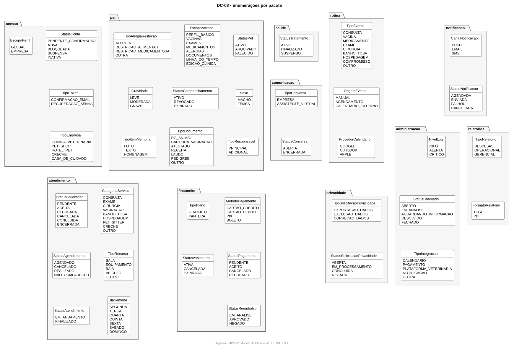

| Pacote | Enumeração | Valores |
|---|---|---|
| `acesso` | `StatusConta` | PENDENTE_CONFIRMACAO, ATIVA, BLOQUEADA, SUSPENSA, INATIVA |
| `acesso` | `TipoToken` | CONFIRMACAO_EMAIL, RECUPERACAO_SENHA |
| `acesso` | `TipoEmpresa` | CLINICA_VETERINARIA, PET_SHOP, HOTEL_PET, CRECHE, CASA_DE_CUIDADO |
| `acesso` | `EscopoPerfil` | GLOBAL, EMPRESA |
| `pet` | `StatusPet` | ATIVO, ARQUIVADO, FALECIDO |
| `pet` | `Sexo` | MACHO, FEMEA |
| `pet` | `TipoResponsavel` | PRINCIPAL, ADICIONAL |
| `pet` | `EscopoAcesso` | PERFIL_BASICO, VACINAS, EXAMES, MEDICAMENTOS, ALERGIAS, DOCUMENTOS, LINHA_DO_TEMPO, EDICAO_CLINICA |
| `pet` | `StatusCompartilhamento` | ATIVO, REVOGADO, EXPIRADO |
| `pet` | `TipoDocumento` | RG_ANIMAL, CARTEIRA_VACINACAO, ATESTADO, RECEITA, LAUDO, PEDIGREE, OUTRO |
| `pet` | `TipoAlergiaRestricao` | ALERGIA, RESTRICAO_ALIMENTAR, RESTRICAO_MEDICAMENTOSA, OUTRA |
| `pet` | `Gravidade` | LEVE, MODERADA, GRAVE |
| `pet` | `TipoItemMemorial` | FOTO, TEXTO, HOMENAGEM |
| `saude` | `StatusTratamento` | ATIVO, FINALIZADO, SUSPENSO |
| `rotina` | `TipoEvento` | CONSULTA, VACINA, MEDICAMENTO, EXAME, CIRURGIA, BANHO_TOSA, HOSPEDAGEM, COMPROMISSO, OUTRO |
| `rotina` | `OrigemEvento` | MANUAL, AGENDAMENTO, CALENDARIO_EXTERNO |
| `rotina` | `ProvedorCalendario` | GOOGLE, OUTLOOK, APPLE |
| `notificacao` | `CanalNotificacao` | PUSH, EMAIL, SMS |
| `notificacao` | `StatusNotificacao` | AGENDADA, ENVIADA, FALHOU, CANCELADA |
| `atendimento` | `CategoriaServico` | CONSULTA, EXAME, CIRURGIA, VACINACAO, BANHO_TOSA, HOSPEDAGEM, PET_SITTER, CRECHE, OUTRO |
| `atendimento` | `TipoRecurso` | SALA, EQUIPAMENTO, BAIA, VEICULO, OUTRO |
| `atendimento` | `DiaSemana` | SEGUNDA, TERCA, QUARTA, QUINTA, SEXTA, SABADO, DOMINGO |
| `atendimento` | `StatusSolicitacao` | PENDENTE, ACEITA, RECUSADA, CANCELADA, CONCLUIDA, ENCERRADA |
| `atendimento` | `StatusAgendamento` | AGENDADO, CANCELADO, REALIZADO, NAO_COMPARECEU |
| `atendimento` | `StatusAtendimento` | EM_ANDAMENTO, FINALIZADO |
| `financeiro` | `MetodoPagamento` | CARTAO_CREDITO, CARTAO_DEBITO, PIX, BOLETO |
| `financeiro` | `StatusPagamento` | PENDENTE, ACEITO, CANCELADO, RECUSADO |
| `financeiro` | `StatusReembolso` | EM_ANALISE, APROVADO, NEGADO |
| `financeiro` | `TipoPlano` | GRATUITO, PANTERA |
| `financeiro` | `StatusAssinatura` | ATIVA, CANCELADA, EXPIRADA |
| `comunicacao` | `TipoConversa` | EMPRESA, ASSISTENTE_VIRTUAL |
| `comunicacao` | `StatusConversa` | ABERTA, ENCERRADA |
| `privacidade` | `TipoSolicitacaoPrivacidade` | EXPORTACAO_DADOS, EXCLUSAO_DADOS, CORRECAO_DADOS |
| `privacidade` | `StatusSolicitacaoPrivacidade` | ABERTA, EM_PROCESSAMENTO, CONCLUIDA, NEGADA |
| `administracao` | `NivelLog` | INFO, ALERTA, CRITICO |
| `administracao` | `StatusChamado` | ABERTO, EM_ANALISE, AGUARDANDO_INFORMACAO, RESOLVIDO, FECHADO |
| `administracao` | `TipoIntegracao` | CALENDARIO, PAGAMENTO, PLATAFORMA_VETERINARIA, NOTIFICACAO, OUTRA |
| `relatorios` | `TipoRelatorio` | DESPESAS, OPERACIONAL, GERENCIAL |
| `relatorios` | `FormatoRelatorio` | TELA, PDF |

## 9. Restrições de integridade

Restrições que a notação gráfica não expressa. Escritas em OCL quando possível; em português quando a regra depende de tempo ou de outro processo.

| ID | Contexto | Restrição | Origem |
|---|---|---|---|
| RC-01 | `Usuario` | status = StatusConta::ATIVA implies emailConfirmado | RN02 |
| RC-02 | `Usuario` | tentativasLoginFalhas >= 5 implies bloqueadoAte = agora + 5 min | RN03 |
| RC-03 | `Sessao` | estaExpirada() = (agora - ultimaAtividade) > 4 h | RN04 |
| RC-04 | `TokenAcesso` | tipo = TipoToken::RECUPERACAO_SENHA implies expiraEm = criadoEm + 2 h | RN05 |
| RC-05 | `Usuario` | a nova senha não confere com nenhum senhasAnteriores->senhaHash (3 últimas) | RN06 |
| RC-06 | `Tutor, EmpresaEnterprise` | cpf e cnpj são {unique} em todo o sistema | RN01 |
| RC-07 | `FuncionarioEnterprise` | not ativo implies sessoes->forAll(s | s.estaExpirada()) | RN23 |
| RC-08 | `FuncionarioEnterprise` | perfil.escopo = EscopoPerfil::EMPRESA and perfil.dona = empregador | RN20 |
| RC-09 | `Pet` | ResponsavelPet->select(r | r.ativo and r.tipo = TipoResponsavel::PRINCIPAL)->size() >= 1 | RN09 |
| RC-10 | `Pet` | possuiHistorico() implies excluir() não é permitido; usa-se arquivar() | RN08 |
| RC-11 | `Pet` | memorial->notEmpty() implies status = StatusPet::FALECIDO | RN19 |
| RC-12 | `Pet` | raca é escolhida da lista de Raca da Especie cadastrada | RN07 |
| RC-13 | `Vacinacao` | consulta exibe apenas registros com valido = true | RN16 |
| RC-14 | `TratamentoMedicamentoso` | status = StatusTratamento::ATIVO implies existem Notificacao agendadas; finalizar() cancela as pendentes | RN18 |
| RC-15 | `CompartilhamentoPet` | empresa só acessa dados do pet se status = ATIVO e o escopo pedido está em escopos, ou se há Agendamento da empresa para o pet | RN15, RN24, RN26, RN30 |
| RC-16 | `CalendarioExterno` | sincronizar() requer autorizado = true | RN13 |
| RC-17 | `PlanoAlimentar` | excedeuLimite(d) = consumoDoDia(d) > limiteDiarioGramas (gera alerta) | RN12 |
| RC-18 | `Despesa` | categoria tem multiplicidade 1 | RN10 |
| RC-19 | `EventoCalendario, Agendamento` | não há sobreposição de horário para o mesmo pet, profissional ou recurso entre agendamentos ativos | RN14, RN29 |
| RC-20 | `HorarioAtuacao` | {xor} profissional ou recurso; horários do mesmo dono não se sobrepõem | RN29 |
| RC-21 | `Agendamento` | precoContratado = servico.preco no momento da criação e não muda depois ({readOnly}) | RN27 |
| RC-22 | `SolicitacaoServico` | toda mudança de status cria um HistoricoSolicitacao com autor | RN38 |
| RC-23 | `SolicitacaoServico` | agendamento->notEmpty() implies status em {ACEITA, CONCLUIDA} | RN40 |
| RC-24 | `Atendimento` | status = FINALIZADO implies alterações apenas por alterarComAuditoria(), que gera LogAuditoria | RN28 |
| RC-25 | `Cliente` | consentimentoLGPD = true para salvar o cadastro | RN25 |
| RC-26 | `Pagamento` | status = StatusPagamento::ACEITO implies dataConfirmacao->notEmpty() | RN39 |
| RC-27 | `Pagamento` | {xor} agendamento ou assinatura | RF43 |
| RC-28 | `Conversa` | tipo = ASSISTENTE_VIRTUAL implies tutor.assinaturas->exists(a | a.plano = PANTERA and a.estaAtiva()); tipo = EMPRESA implies empresa->notEmpty() | RF42 |
| RC-29 | `Webhook` | url começa com https:// e metodoAutenticacao não é vazio | RN36 |
| RC-30 | `Integracao` | criar ou alterar exige Administrador com a permissão de integrações | RN33 |
| RC-31 | `IntervencaoSuporte, Usuario` | toda intervenção e toda mudança de status de conta gera LogAuditoria | RN32, RN34 |
| RC-32 | `Relatorio` | o conteúdo respeita o perfil de quem gera; empresa vê só a própria operação | RN21, RN22 |

## 10. Rastreabilidade

| RF | Requisito | Classes |
|---|---|---|
| RF01 | Cadastro de usuário | Usuario, Tutor, EmpresaEnterprise, TokenAcesso |
| RF02 | Autenticação | Usuario, Sessao |
| RF03 | Recuperação de senha | TokenAcesso, HistoricoSenha |
| RF04 | Gerenciar pet | Pet, Especie, Raca |
| RF05 | Vincular responsável | ResponsavelPet |
| RF06 | Controlar despesas | Despesa, CategoriaDespesa |
| RF07 | Relatório de despesas | Relatorio |
| RF08 | Registrar alimentação | PlanoAlimentar, RegistroAlimentacao |
| RF09 | Calendário externo | CalendarioExterno |
| RF10 | Gerenciar calendário | EventoCalendario |
| RF11 | Compartilhar perfil | CompartilhamentoPet |
| RF12, RF13 | Vacinação | Vacinacao |
| RF14 | Medicamentos | TratamentoMedicamentoso, Notificacao |
| RF15 | Memorial | Memorial, ItemMemorial |
| RF16 | Permissões de funcionários | PerfilAcesso, Permissao |
| RF17 | Emitir BI | Consulta sobre Agendamento, Atendimento e Pagamento (sem classe própria) |
| RF18 | Relatórios da empresa | Relatorio |
| RF19 | Gerenciar funcionários | FuncionarioEnterprise |
| RF20, RF22 | Pets vinculados e perfil | CompartilhamentoPet, Agendamento |
| RF21 | Gerenciar clientes | Cliente |
| RF23 | Serviços e atendimentos | Atendimento, ItemAtendimento |
| RF25 | Controlar agenda | Agendamento, HorarioAtuacao, Recurso |
| RF26 | Monitorar desempenho e logs | LogAuditoria (métricas vêm da infraestrutura) |
| RF27 | Suporte operacional | ChamadoSuporte, IntervencaoSuporte |
| RF28 | Integrações | Integracao |
| RF29 | Contas de usuários | Usuario, LogAuditoria |
| RF30 | Permissões globais | PerfilAcesso, Permissao |
| RF31 | Webhooks | Webhook |
| RF32 | Notificações automáticas | Notificacao, ConfiguracaoNotificacao, Notificavel |
| RF33 | Documentos do pet | DocumentoPet |
| RF34 | Linha do tempo | Consulta sobre RegistroClinico, EventoCalendario e Atendimento (sem classe própria) |
| RF35 | Exames | Exame |
| RF36 | Alergias e restrições | AlergiaRestricao |
| RF37 | Catálogo de serviços | Servico |
| RF38 | Agendar serviço (empresa) | Agendamento |
| RF39 | Solicitar agendamento (tutor) | SolicitacaoServico |
| RF40, RF41 | Gerenciar e acompanhar solicitações | SolicitacaoServico, HistoricoSolicitacao |
| RF42 | Chat | Conversa, Mensagem, Assinatura |
| RF43, RF44 | Pagamentos | Pagamento, SolicitacaoReembolso |
| RF45 | Privacidade e consentimentos | TermoUso, Consentimento, SolicitacaoPrivacidade |

O RF24 foi descontinuado e incorporado ao RF23.

## 11. Questões em aberto

| ID | Questão | Encaminhamento |
|---|---|---|
| QA-01 | As abas JGR002 a JGR008 da planilha de casos de uso ainda têm o texto do modelo. As classes desses casos foram derivadas do RF e das RN. | Completar as especificações (tarefa no backlog). |
| QA-02 | RF42 descreve chat entre tutor e empresa; JGR044 descreve assistente com plano PANTERA. O modelo aceita os dois (TipoConversa). | Grupo decide o escopo da v1.0. |
| QA-03 | Cliente pressupõe que todo cliente da empresa é um Tutor cadastrado. | Confirmar com o grupo. Se não for, Cliente ganha nome, CPF e contato. |
| QA-04 | Assinatura e plano PANTERA aparecem só no JGR044. | Confirmar se planos pagos entram na v1.0. |

## 12. Manutenção dos diagramas

Os arquivos `.puml` em `diagrama-de-classes/` são a fonte. Para gerar as imagens em `diagrama-de-classes/img/`:

- **VS Code:** extensão *PlantUML* (jebbs.plantuml) → `PlantUML: Export Workspace Diagrams`, formato SVG.
- **Docker** (sem instalar Java), na pasta `diagrama-de-classes`: `docker run --rm -v "$PWD:/data" -w /data plantuml/plantuml:1.2024.7 -tsvg -charset UTF-8 -o img "DC-*.puml"`.
- **Linha de comando:** `java -jar plantuml.jar -tsvg -charset UTF-8 -o img diagrama-de-classes/*.puml` (requer Java e Graphviz).

Toda mudança no modelo atualiza o `.puml`, este documento e o histórico de revisões.
