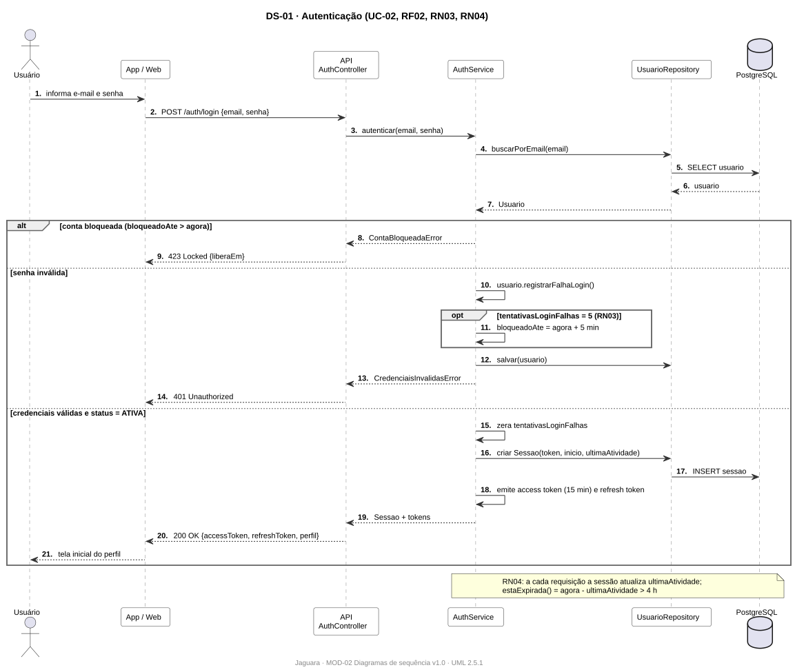
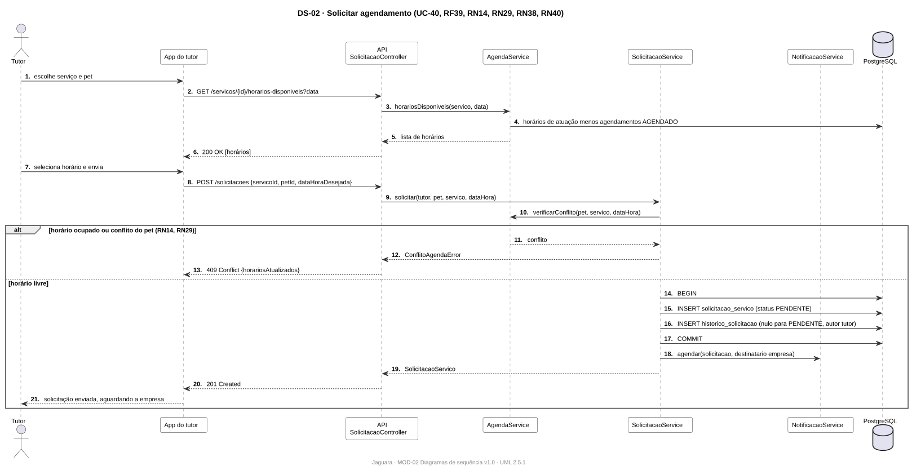
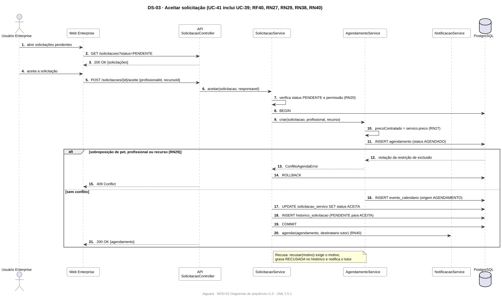
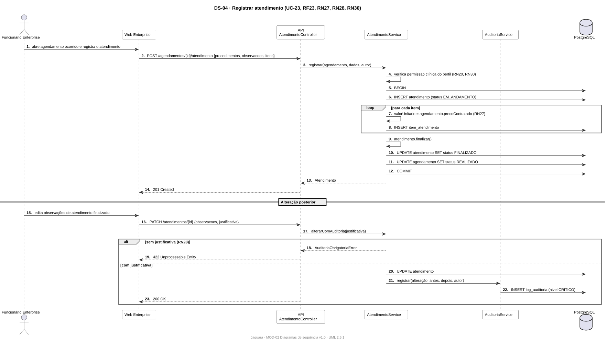
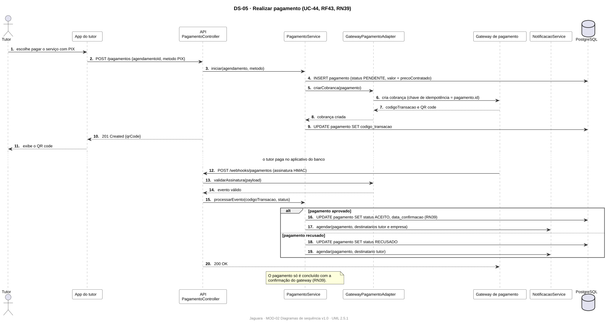
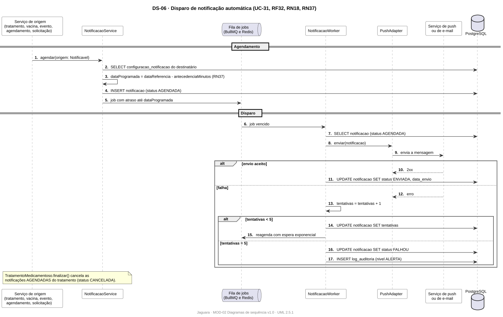

# MOD-02 · Diagramas de sequência

| Campo | Valor |
|---|---|
| Projeto | Jaguara |
| Documento | MOD-02 · Diagramas de sequência |
| Versão | 2.0 |
| Status | Em revisão |
| Autores | Micaela Dorneles (versão 1), Ricardo Guilhen (versão 2) |
| Data | 01/11/2026 |
| Tarefa Jira | JAG-26 |
| Padrão de referência | UML 2.5.1, diagrama de sequência |
| Original | [MOD-02-diagramas-de-sequencia-original.pdf](../anexos/originais/MOD-02-diagramas-de-sequencia-original.pdf) |

## Histórico de revisões

| Versão | Data | Autor | Descrição |
|---|---|---|---|
| 1.0 | 30/10/2026 | Micaela Dorneles | Diagramas dos seis fluxos obrigatórios e dos demais casos de uso (JGR001 a JGR046), em imagem. |
| 2.0 | 01/11/2026 | Ricardo Guilhen | Fluxos obrigatórios redesenhados em PlantUML com as classes e operações do MOD-01 e as camadas da arquitetura (ARQ-01). |

## 1. Objetivo

Mostrar a troca de mensagens entre usuário, aplicativos, API, serviços de domínio, banco de dados e sistemas externos nos fluxos mais críticos do Jaguara, deixando explícito onde cada regra de negócio é verificada.

## 2. Escopo

- **Versão 2 (este documento):** os seis fluxos obrigatórios, em PlantUML, versionados e coerentes com o [MOD-01](MOD-01-modelo-de-classes.md), o [MOD-03](MOD-03-modelo-de-dados.md).
- **Versão 1 (anexo):** os diagramas dos 46 casos de uso elaborados pela Micaela continuam válidos como visão de alto nível e estão no [PDF original](../anexos/originais/MOD-02-diagramas-de-sequencia-original.pdf).

## 3. Convenções

- Participantes seguem as camadas da arquitetura ([ADR-004](../03-arquitetura/adr/ADR-004-stack-backend.md)): aplicação cliente → controlador da API → serviço de domínio → repositório ou adaptador → banco ou sistema externo.
- Mensagens síncronas com seta cheia; retornos com seta tracejada; blocos `alt`, `opt` e `loop` da UML.
- Cada diagrama cita o caso de uso e as regras que exercita.

## 4. Diagramas

### 4.1 DS-01 · Autenticação

Caso de uso UC-02. Mostra o bloqueio temporário após cinco falhas (RN03) e a expiração da sessão por inatividade (RN04).

### 4.2 DS-02 · Solicitar agendamento

Caso de uso UC-40. Os horários disponíveis vêm dos horários de atuação menos os agendamentos; a verificação de conflito é refeita no envio (RN14, RN29); a solicitação nasce PENDENTE com histórico (RN38).

### 4.3 DS-03 · Aceitar solicitação

Caso de uso UC-41, que inclui o UC-39. O agendamento congela o preço (RN27) e a restrição de exclusão do banco impede sobreposição (RN29), tudo em uma transação.

### 4.4 DS-04 · Registrar atendimento

Caso de uso UC-23. Itens cobrados pelo preço contratado (RN27); depois de finalizado, o atendimento só muda com justificativa e registro de auditoria (RN28).

### 4.5 DS-05 · Realizar pagamento

Caso de uso UC-44. O pagamento nasce PENDENTE e só vira ACEITO pela confirmação assinada do gateway (RN39).

### 4.6 DS-06 · Disparo de notificação automática

Caso de uso UC-31. Qualquer classe `Notificavel` agenda a notificação com a antecedência do usuário (RN37); um *worker* dispara e reagenda em caso de falha.

Fontes: [`diagramas-de-sequencia/`](diagramas-de-sequencia).
