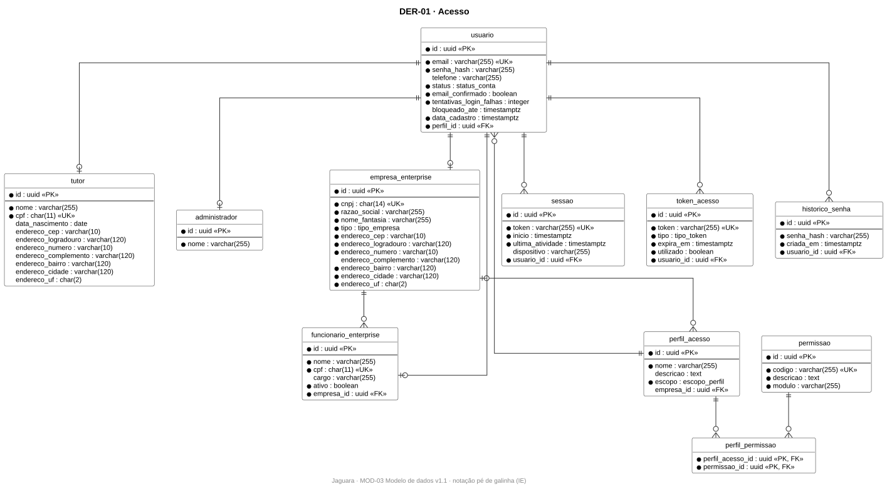
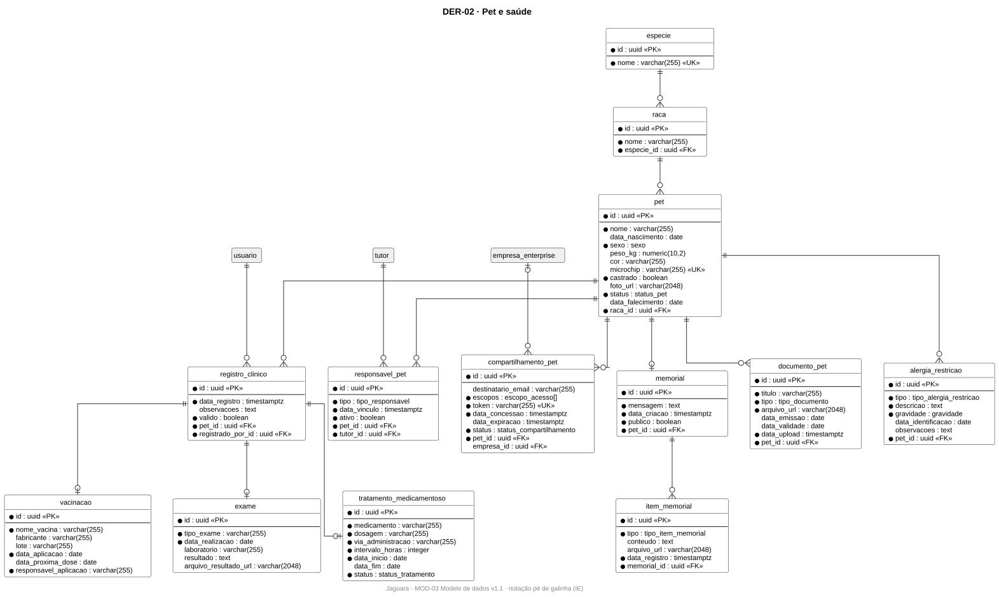
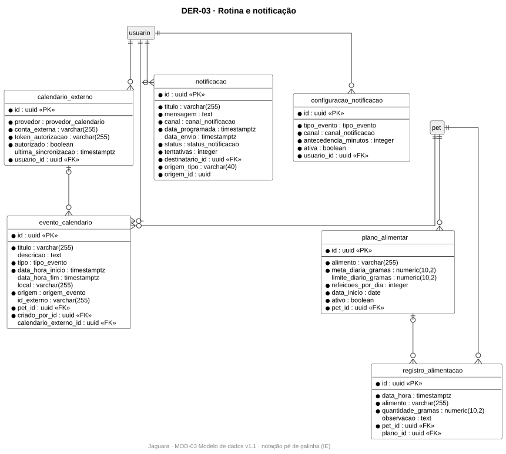
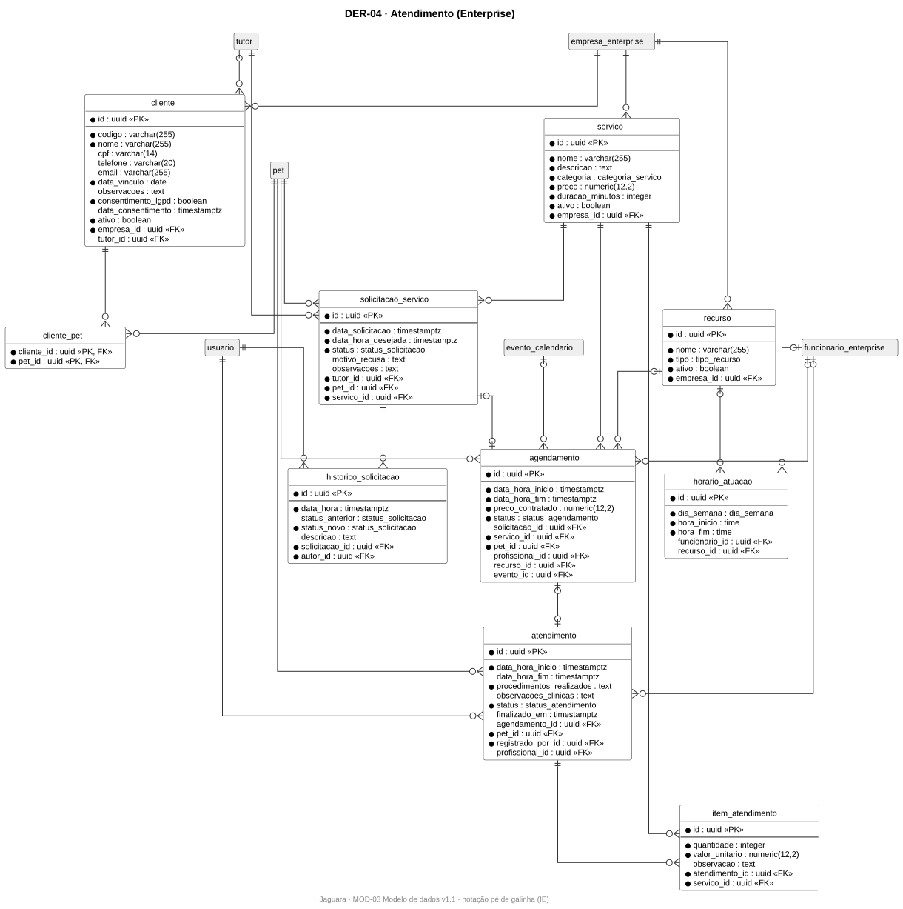
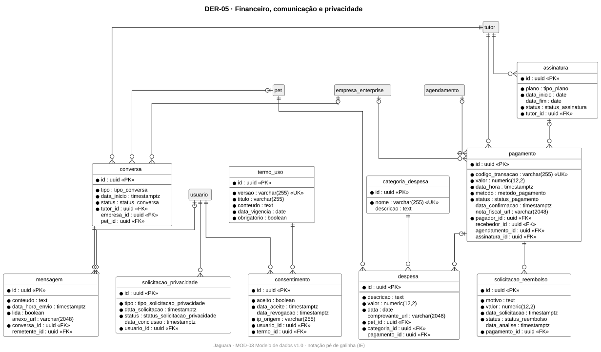
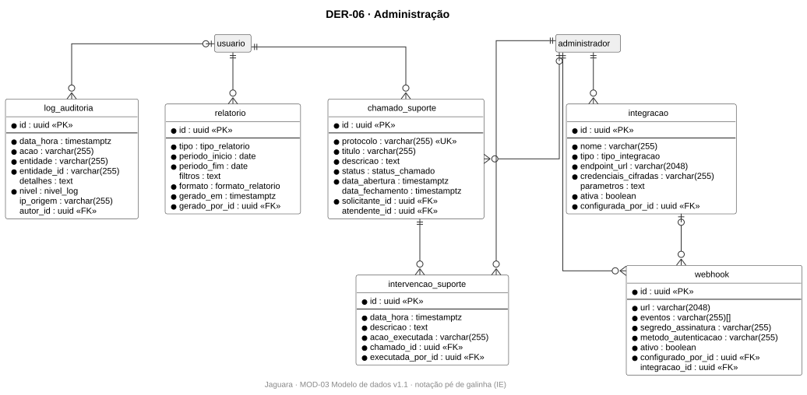

# MOD-03 · Modelo de dados

| Campo | Valor |
|---|---|
| Projeto | Jaguara |
| Documento | MOD-03 · Modelo de dados (DER lógico, modelo físico e dicionário de dados) |
| Versão | 1.0 |
| Status | Em revisão |
| Autores | Ricardo Guilhen |
| Data | 01/11/2026 |
| Tarefa Jira | JAG-47 (modelo lógico), JAG-48 (modelo físico) |
| Padrão de referência | Diagrama Entidade-Relacionamento em notação pé de galinha (Information Engineering); PostgreSQL 16 |

## Histórico de revisões

| Versão | Data | Autor | Descrição |
|---|---|---|---|
| 1.0 | 01/11/2026 | Ricardo Guilhen | Modelo derivado do MOD-01: DER por área, dicionário de dados e DDL PostgreSQL. |

## 1. Objetivo

Definir como as classes persistentes do [modelo de classes (MOD-01)](MOD-01-modelo-de-classes.md) são armazenadas no PostgreSQL ([ADR-005](../03-arquitetura/adr/ADR-005-banco-de-dados.md)): tabelas, colunas, tipos, chaves, restrições e índices.

## 2. Escopo

- **Modelo lógico:** os DER da seção 4, um por área do domínio.
- **Modelo físico:** o script [`MOD-03-schema.sql`](modelo-de-dados/MOD-03-schema.sql), executável em PostgreSQL 16, e o dicionário da seção 7.
- Fora do escopo: migrações versionadas, que vivem no repositório do backend e são geradas a partir deste modelo (Prisma Migrate, [ADR-004](../03-arquitetura/adr/ADR-004-stack-backend.md)).

## 3. Regras de mapeamento classe → tabela

| Elemento do MOD-01 | Mapeamento | Exemplo |
|---|---|---|
| Classe persistente | Uma tabela com nome em `snake_case` | `SolicitacaoServico` → `solicitacao_servico` |
| Identidade | Coluna `id uuid` gerada pelo banco (`gen_random_uuid()`) | todas as tabelas |
| Herança (`Usuario`, `RegistroClinico`) | Tabela por classe com chave primária compartilhada: a subclasse usa o mesmo `id` da superclasse | `tutor.id` → `usuario.id` |
| Atributo `[0..1]` | Coluna que aceita nulo | `pet.data_falecimento` |
| Atributo `[1..*]` | Coluna do tipo vetor do PostgreSQL | `compartilhamento_pet.escopos escopo_acesso[]` |
| Enumeração | Tipo `ENUM` do PostgreSQL com os mesmos valores | `status_pagamento` |
| `«dataType» Endereco` | Colunas embutidas com prefixo | `tutor.endereco_cep` |
| Associação 1 para N | Chave estrangeira no lado N | `pet.raca_id` |
| Composição | Chave estrangeira com `ON DELETE CASCADE` | `item_memorial.memorial_id` |
| Associação N para N sem atributos | Tabela de junção | `perfil_permissao` |
| Classe de associação | Tabela com as duas chaves estrangeiras e restrição de unicidade | `responsavel_pet`, `cliente` |
| Interface `Notificavel` | Referência polimórfica (`origem_tipo`, `origem_id`) | `notificacao` |
| `{unique}` | `UNIQUE` | `usuario.email` |
| Atributo derivado (`/idade`) | Não é armazenado; calculado na consulta | — |
| Todas as tabelas | `criado_em` e `atualizado_em` para auditoria | — |

## 4. Diagramas ER

Entidades em cinza pertencem a outra área e aparecem só como referência. Colunas com `*` são obrigatórias.

### 4.1 DER-01 · Acesso

### 4.2 DER-02 · Pet e saúde

### 4.3 DER-03 · Rotina e notificação

### 4.4 DER-04 · Atendimento (Enterprise)

### 4.5 DER-05 · Financeiro, comunicação e privacidade

### 4.6 DER-06 · Administração

Fontes: [`modelo-de-dados/`](modelo-de-dados).

## 5. Modelo físico

O script [`MOD-03-schema.sql`](modelo-de-dados/MOD-03-schema.sql) cria os 39 tipos enumerados, as 55 tabelas (54 entidades e a associativa `perfil_permissao`), as 85 chaves estrangeiras, as restrições de negócio e os índices. Ele é validado executando-o em um PostgreSQL 16 limpo.

## 6. Restrições de negócio no banco

As regras que o banco consegue garantir sozinho ficam no banco; as demais ficam nos serviços de domínio ([MOD-01](MOD-01-modelo-de-classes.md), seção 9).

| Restrição | Regra | Implementação |
|---|---|---|
| CPF, CNPJ e e-mail únicos | RN01 | `UNIQUE` |
| Conta ativa só com e-mail confirmado | RN02, RC-01 | `CHECK` em `usuario` |
| Responsável e cliente sem duplicidade | RN09, RN25 | `UNIQUE (pet_id, tutor_id)` e `UNIQUE (empresa_id, tutor_id)` |
| Despesa sempre com categoria | RN10 | `categoria_id NOT NULL` |
| Vacinação com responsável | RN17 | `NOT NULL` e `CHECK` de texto não vazio |
| Sem sobreposição de agendamentos ativos | RN14, RN29, RC-19 | `EXCLUDE USING gist` por pet, profissional e recurso |
| Horário de atuação de profissional ou de recurso | RC-20 | `CHECK` de exclusividade |
| Pagamento de agendamento ou de assinatura | RC-27 | `CHECK` de exclusividade |
| Pagamento aceito só com confirmação | RN39, RC-26 | `CHECK (status <> 'ACEITO' OR data_confirmacao IS NOT NULL)` |
| Webhook só HTTPS | RN36, RC-29 | `CHECK (url LIKE 'https://%')` |
| Preço contratado imutável | RN27, RC-21 | Coluna própria em `agendamento`; o serviço de domínio não atualiza |
| Pet com histórico não é excluído | RN08 | `ON DELETE RESTRICT` em `registro_clinico`, `despesa` e `agendamento`, mais regra no serviço |

## 7. Dicionário de dados

### DER-01

#### `usuario`

Classe de origem: `Usuario`.

| Coluna | Tipo | Nulo | Restrição | Observação |
|---|---|---|---|---|
| `id` | `uuid` | não | PK | Identificador |
| `email` | `varchar(255)` | não | UNIQUE |  |
| `senha_hash` | `varchar(255)` | não |  |  |
| `telefone` | `varchar(255)` | sim |  |  |
| `status` | `status_conta` | não |  |  |
| `email_confirmado` | `boolean` | não |  |  |
| `tentativas_login_falhas` | `integer` | não |  |  |
| `bloqueado_ate` | `timestamptz` | sim |  |  |
| `data_cadastro` | `timestamptz` | não |  |  |
| `perfil_id` | `uuid` | não | FK → perfil_acesso.id |  |
| `criado_em` | `timestamptz` | não | DEFAULT now() | Auditoria de criação |
| `atualizado_em` | `timestamptz` | não | DEFAULT now() | Auditoria de alteração |

#### `tutor` (especialização de `usuario`, chave compartilhada)

Classe de origem: `Tutor`.

| Coluna | Tipo | Nulo | Restrição | Observação |
|---|---|---|---|---|
| `id` | `uuid` | não | PK, FK → usuario.id | Identificador |
| `nome` | `varchar(255)` | não |  |  |
| `cpf` | `char(11)` | não | UNIQUE |  |
| `data_nascimento` | `date` | sim |  |  |
| `endereco_cep` | `varchar(10)` | sim |  | Endereço: cep |
| `endereco_logradouro` | `varchar(120)` | sim |  | Endereço: logradouro |
| `endereco_numero` | `varchar(10)` | sim |  | Endereço: numero |
| `endereco_complemento` | `varchar(120)` | sim |  | Endereço: complemento |
| `endereco_bairro` | `varchar(120)` | sim |  | Endereço: bairro |
| `endereco_cidade` | `varchar(120)` | sim |  | Endereço: cidade |
| `endereco_uf` | `char(2)` | sim |  | Endereço: uf |
| `criado_em` | `timestamptz` | não | DEFAULT now() | Auditoria de criação |
| `atualizado_em` | `timestamptz` | não | DEFAULT now() | Auditoria de alteração |

#### `administrador` (especialização de `usuario`, chave compartilhada)

Classe de origem: `Administrador`.

| Coluna | Tipo | Nulo | Restrição | Observação |
|---|---|---|---|---|
| `id` | `uuid` | não | PK, FK → usuario.id | Identificador |
| `nome` | `varchar(255)` | não |  |  |
| `criado_em` | `timestamptz` | não | DEFAULT now() | Auditoria de criação |
| `atualizado_em` | `timestamptz` | não | DEFAULT now() | Auditoria de alteração |

#### `empresa_enterprise` (especialização de `usuario`, chave compartilhada)

Classe de origem: `EmpresaEnterprise`.

| Coluna | Tipo | Nulo | Restrição | Observação |
|---|---|---|---|---|
| `id` | `uuid` | não | PK, FK → usuario.id | Identificador |
| `cnpj` | `char(14)` | não | UNIQUE |  |
| `razao_social` | `varchar(255)` | não |  |  |
| `nome_fantasia` | `varchar(255)` | não |  |  |
| `tipo` | `tipo_empresa` | não |  |  |
| `endereco_cep` | `varchar(10)` | não |  | Endereço: cep |
| `endereco_logradouro` | `varchar(120)` | não |  | Endereço: logradouro |
| `endereco_numero` | `varchar(10)` | não |  | Endereço: numero |
| `endereco_complemento` | `varchar(120)` | sim |  | Endereço: complemento |
| `endereco_bairro` | `varchar(120)` | não |  | Endereço: bairro |
| `endereco_cidade` | `varchar(120)` | não |  | Endereço: cidade |
| `endereco_uf` | `char(2)` | não |  | Endereço: uf |
| `criado_em` | `timestamptz` | não | DEFAULT now() | Auditoria de criação |
| `atualizado_em` | `timestamptz` | não | DEFAULT now() | Auditoria de alteração |

#### `funcionario_enterprise` (especialização de `usuario`, chave compartilhada)

Classe de origem: `FuncionarioEnterprise`.

| Coluna | Tipo | Nulo | Restrição | Observação |
|---|---|---|---|---|
| `id` | `uuid` | não | PK, FK → usuario.id | Identificador |
| `nome` | `varchar(255)` | não |  |  |
| `cpf` | `char(11)` | não | UNIQUE |  |
| `cargo` | `varchar(255)` | sim |  |  |
| `ativo` | `boolean` | não |  |  |
| `empresa_id` | `uuid` | não | FK → empresa_enterprise.id | empregador |
| `criado_em` | `timestamptz` | não | DEFAULT now() | Auditoria de criação |
| `atualizado_em` | `timestamptz` | não | DEFAULT now() | Auditoria de alteração |

#### `sessao`

Classe de origem: `Sessao`.

| Coluna | Tipo | Nulo | Restrição | Observação |
|---|---|---|---|---|
| `id` | `uuid` | não | PK | Identificador |
| `token` | `varchar(255)` | não | UNIQUE |  |
| `inicio` | `timestamptz` | não |  |  |
| `ultima_atividade` | `timestamptz` | não |  |  |
| `dispositivo` | `varchar(255)` | sim |  |  |
| `usuario_id` | `uuid` | não | FK → usuario.id |  |
| `criado_em` | `timestamptz` | não | DEFAULT now() | Auditoria de criação |
| `atualizado_em` | `timestamptz` | não | DEFAULT now() | Auditoria de alteração |

#### `token_acesso`

Classe de origem: `TokenAcesso`.

| Coluna | Tipo | Nulo | Restrição | Observação |
|---|---|---|---|---|
| `id` | `uuid` | não | PK | Identificador |
| `token` | `varchar(255)` | não | UNIQUE |  |
| `tipo` | `tipo_token` | não |  |  |
| `criado_em` | `timestamptz` | não |  |  |
| `expira_em` | `timestamptz` | não |  |  |
| `utilizado` | `boolean` | não |  |  |
| `usuario_id` | `uuid` | não | FK → usuario.id |  |
| `atualizado_em` | `timestamptz` | não | DEFAULT now() | Auditoria de alteração |

#### `historico_senha`

Classe de origem: `HistoricoSenha`.

| Coluna | Tipo | Nulo | Restrição | Observação |
|---|---|---|---|---|
| `id` | `uuid` | não | PK | Identificador |
| `senha_hash` | `varchar(255)` | não |  |  |
| `criada_em` | `timestamptz` | não |  |  |
| `usuario_id` | `uuid` | não | FK → usuario.id | até 3 por usuário (RC-05) |
| `criado_em` | `timestamptz` | não | DEFAULT now() | Auditoria de criação |
| `atualizado_em` | `timestamptz` | não | DEFAULT now() | Auditoria de alteração |

#### `perfil_acesso`

Classe de origem: `PerfilAcesso`.

| Coluna | Tipo | Nulo | Restrição | Observação |
|---|---|---|---|---|
| `id` | `uuid` | não | PK | Identificador |
| `nome` | `varchar(255)` | não |  |  |
| `descricao` | `text` | sim |  |  |
| `escopo` | `escopo_perfil` | não |  |  |
| `empresa_id` | `uuid` | sim | FK → empresa_enterprise.id | nulo = perfil GLOBAL |
| `criado_em` | `timestamptz` | não | DEFAULT now() | Auditoria de criação |
| `atualizado_em` | `timestamptz` | não | DEFAULT now() | Auditoria de alteração |

#### `permissao`

Classe de origem: `Permissao`.

| Coluna | Tipo | Nulo | Restrição | Observação |
|---|---|---|---|---|
| `id` | `uuid` | não | PK | Identificador |
| `codigo` | `varchar(255)` | não | UNIQUE |  |
| `descricao` | `text` | não |  |  |
| `modulo` | `varchar(255)` | não |  |  |
| `criado_em` | `timestamptz` | não | DEFAULT now() | Auditoria de criação |
| `atualizado_em` | `timestamptz` | não | DEFAULT now() | Auditoria de alteração |

### DER-02

#### `pet`

Classe de origem: `Pet`.

| Coluna | Tipo | Nulo | Restrição | Observação |
|---|---|---|---|---|
| `id` | `uuid` | não | PK | Identificador |
| `nome` | `varchar(255)` | não |  |  |
| `data_nascimento` | `date` | sim |  |  |
| `sexo` | `sexo` | não |  |  |
| `peso_kg` | `numeric(10,2)` | sim |  |  |
| `cor` | `varchar(255)` | sim |  |  |
| `microchip` | `varchar(255)` | sim | UNIQUE |  |
| `castrado` | `boolean` | não |  |  |
| `foto_url` | `varchar(2048)` | sim |  |  |
| `status` | `status_pet` | não |  |  |
| `data_falecimento` | `date` | sim |  |  |
| `raca_id` | `uuid` | não | FK → raca.id |  |
| `criado_em` | `timestamptz` | não | DEFAULT now() | Auditoria de criação |
| `atualizado_em` | `timestamptz` | não | DEFAULT now() | Auditoria de alteração |

#### `especie`

Classe de origem: `Especie`.

| Coluna | Tipo | Nulo | Restrição | Observação |
|---|---|---|---|---|
| `id` | `uuid` | não | PK | Identificador |
| `nome` | `varchar(255)` | não | UNIQUE |  |
| `criado_em` | `timestamptz` | não | DEFAULT now() | Auditoria de criação |
| `atualizado_em` | `timestamptz` | não | DEFAULT now() | Auditoria de alteração |

#### `raca`

Classe de origem: `Raca`.

| Coluna | Tipo | Nulo | Restrição | Observação |
|---|---|---|---|---|
| `id` | `uuid` | não | PK | Identificador |
| `nome` | `varchar(255)` | não |  |  |
| `especie_id` | `uuid` | não | FK → especie.id |  |
| `criado_em` | `timestamptz` | não | DEFAULT now() | Auditoria de criação |
| `atualizado_em` | `timestamptz` | não | DEFAULT now() | Auditoria de alteração |

#### `responsavel_pet`

Classe de origem: `ResponsavelPet`.

| Coluna | Tipo | Nulo | Restrição | Observação |
|---|---|---|---|---|
| `id` | `uuid` | não | PK | Identificador |
| `tipo` | `tipo_responsavel` | não |  |  |
| `data_vinculo` | `timestamptz` | não |  |  |
| `ativo` | `boolean` | não |  |  |
| `pet_id` | `uuid` | não | FK → pet.id |  |
| `tutor_id` | `uuid` | não | FK → tutor.id | classe de associação |
| `criado_em` | `timestamptz` | não | DEFAULT now() | Auditoria de criação |
| `atualizado_em` | `timestamptz` | não | DEFAULT now() | Auditoria de alteração |

#### `compartilhamento_pet`

Classe de origem: `CompartilhamentoPet`.

| Coluna | Tipo | Nulo | Restrição | Observação |
|---|---|---|---|---|
| `id` | `uuid` | não | PK | Identificador |
| `destinatario_email` | `varchar(255)` | sim |  |  |
| `escopos` | `escopo_acesso[]` | não |  |  |
| `token` | `varchar(255)` | não | UNIQUE |  |
| `data_concessao` | `timestamptz` | não |  |  |
| `data_expiracao` | `timestamptz` | sim |  |  |
| `status` | `status_compartilhamento` | não |  |  |
| `pet_id` | `uuid` | não | FK → pet.id |  |
| `empresa_id` | `uuid` | sim | FK → empresa_enterprise.id | nulo = destinatário por e-mail |
| `criado_em` | `timestamptz` | não | DEFAULT now() | Auditoria de criação |
| `atualizado_em` | `timestamptz` | não | DEFAULT now() | Auditoria de alteração |

#### `memorial`

Classe de origem: `Memorial`.

| Coluna | Tipo | Nulo | Restrição | Observação |
|---|---|---|---|---|
| `id` | `uuid` | não | PK | Identificador |
| `mensagem` | `text` | não |  |  |
| `data_criacao` | `timestamptz` | não |  |  |
| `publico` | `boolean` | não |  |  |
| `pet_id` | `uuid` | não | FK → pet.id, UNIQUE | único por pet |
| `criado_em` | `timestamptz` | não | DEFAULT now() | Auditoria de criação |
| `atualizado_em` | `timestamptz` | não | DEFAULT now() | Auditoria de alteração |

#### `item_memorial`

Classe de origem: `ItemMemorial`.

| Coluna | Tipo | Nulo | Restrição | Observação |
|---|---|---|---|---|
| `id` | `uuid` | não | PK | Identificador |
| `tipo` | `tipo_item_memorial` | não |  |  |
| `conteudo` | `text` | sim |  |  |
| `arquivo_url` | `varchar(2048)` | sim |  |  |
| `data_registro` | `timestamptz` | não |  |  |
| `memorial_id` | `uuid` | não | FK → memorial.id |  |
| `criado_em` | `timestamptz` | não | DEFAULT now() | Auditoria de criação |
| `atualizado_em` | `timestamptz` | não | DEFAULT now() | Auditoria de alteração |

#### `documento_pet`

Classe de origem: `DocumentoPet`.

| Coluna | Tipo | Nulo | Restrição | Observação |
|---|---|---|---|---|
| `id` | `uuid` | não | PK | Identificador |
| `titulo` | `varchar(255)` | não |  |  |
| `tipo` | `tipo_documento` | não |  |  |
| `arquivo_url` | `varchar(2048)` | não |  |  |
| `data_emissao` | `date` | sim |  |  |
| `data_validade` | `date` | sim |  |  |
| `data_upload` | `timestamptz` | não |  |  |
| `pet_id` | `uuid` | não | FK → pet.id |  |
| `criado_em` | `timestamptz` | não | DEFAULT now() | Auditoria de criação |
| `atualizado_em` | `timestamptz` | não | DEFAULT now() | Auditoria de alteração |

#### `alergia_restricao`

Classe de origem: `AlergiaRestricao`.

| Coluna | Tipo | Nulo | Restrição | Observação |
|---|---|---|---|---|
| `id` | `uuid` | não | PK | Identificador |
| `tipo` | `tipo_alergia_restricao` | não |  |  |
| `descricao` | `text` | não |  |  |
| `gravidade` | `gravidade` | não |  |  |
| `data_identificacao` | `date` | sim |  |  |
| `observacoes` | `text` | sim |  |  |
| `pet_id` | `uuid` | não | FK → pet.id |  |
| `criado_em` | `timestamptz` | não | DEFAULT now() | Auditoria de criação |
| `atualizado_em` | `timestamptz` | não | DEFAULT now() | Auditoria de alteração |

#### `registro_clinico`

Classe de origem: `RegistroClinico`.

| Coluna | Tipo | Nulo | Restrição | Observação |
|---|---|---|---|---|
| `id` | `uuid` | não | PK | Identificador |
| `data_registro` | `timestamptz` | não |  |  |
| `observacoes` | `text` | sim |  |  |
| `valido` | `boolean` | não |  |  |
| `pet_id` | `uuid` | não | FK → pet.id |  |
| `registrado_por_id` | `uuid` | não | FK → usuario.id |  |
| `criado_em` | `timestamptz` | não | DEFAULT now() | Auditoria de criação |
| `atualizado_em` | `timestamptz` | não | DEFAULT now() | Auditoria de alteração |

#### `vacinacao` (especialização de `registro_clinico`, chave compartilhada)

Classe de origem: `Vacinacao`.

| Coluna | Tipo | Nulo | Restrição | Observação |
|---|---|---|---|---|
| `id` | `uuid` | não | PK, FK → registro_clinico.id | Identificador |
| `nome_vacina` | `varchar(255)` | não |  |  |
| `fabricante` | `varchar(255)` | sim |  |  |
| `lote` | `varchar(255)` | sim |  |  |
| `data_aplicacao` | `date` | não |  |  |
| `data_proxima_dose` | `date` | sim |  |  |
| `responsavel_aplicacao` | `varchar(255)` | não |  |  |
| `criado_em` | `timestamptz` | não | DEFAULT now() | Auditoria de criação |
| `atualizado_em` | `timestamptz` | não | DEFAULT now() | Auditoria de alteração |

#### `exame` (especialização de `registro_clinico`, chave compartilhada)

Classe de origem: `Exame`.

| Coluna | Tipo | Nulo | Restrição | Observação |
|---|---|---|---|---|
| `id` | `uuid` | não | PK, FK → registro_clinico.id | Identificador |
| `tipo_exame` | `varchar(255)` | não |  |  |
| `data_realizacao` | `date` | não |  |  |
| `laboratorio` | `varchar(255)` | sim |  |  |
| `resultado` | `text` | sim |  |  |
| `arquivo_resultado_url` | `varchar(2048)` | sim |  |  |
| `criado_em` | `timestamptz` | não | DEFAULT now() | Auditoria de criação |
| `atualizado_em` | `timestamptz` | não | DEFAULT now() | Auditoria de alteração |

#### `tratamento_medicamentoso` (especialização de `registro_clinico`, chave compartilhada)

Classe de origem: `TratamentoMedicamentoso`.

| Coluna | Tipo | Nulo | Restrição | Observação |
|---|---|---|---|---|
| `id` | `uuid` | não | PK, FK → registro_clinico.id | Identificador |
| `medicamento` | `varchar(255)` | não |  |  |
| `dosagem` | `varchar(255)` | não |  |  |
| `via_administracao` | `varchar(255)` | não |  |  |
| `intervalo_horas` | `integer` | não |  |  |
| `data_inicio` | `date` | não |  |  |
| `data_fim` | `date` | sim |  |  |
| `status` | `status_tratamento` | não |  |  |
| `criado_em` | `timestamptz` | não | DEFAULT now() | Auditoria de criação |
| `atualizado_em` | `timestamptz` | não | DEFAULT now() | Auditoria de alteração |

### DER-03

#### `evento_calendario`

Classe de origem: `EventoCalendario`.

| Coluna | Tipo | Nulo | Restrição | Observação |
|---|---|---|---|---|
| `id` | `uuid` | não | PK | Identificador |
| `titulo` | `varchar(255)` | não |  |  |
| `descricao` | `text` | sim |  |  |
| `tipo` | `tipo_evento` | não |  |  |
| `data_hora_inicio` | `timestamptz` | não |  |  |
| `data_hora_fim` | `timestamptz` | sim |  |  |
| `local` | `varchar(255)` | sim |  |  |
| `origem` | `origem_evento` | não |  |  |
| `id_externo` | `varchar(255)` | sim |  |  |
| `pet_id` | `uuid` | não | FK → pet.id |  |
| `criado_por_id` | `uuid` | não | FK → usuario.id |  |
| `calendario_externo_id` | `uuid` | sim | FK → calendario_externo.id |  |
| `criado_em` | `timestamptz` | não | DEFAULT now() | Auditoria de criação |
| `atualizado_em` | `timestamptz` | não | DEFAULT now() | Auditoria de alteração |

#### `calendario_externo`

Classe de origem: `CalendarioExterno`.

| Coluna | Tipo | Nulo | Restrição | Observação |
|---|---|---|---|---|
| `id` | `uuid` | não | PK | Identificador |
| `provedor` | `provedor_calendario` | não |  |  |
| `conta_externa` | `varchar(255)` | não |  |  |
| `token_autorizacao` | `varchar(255)` | não |  |  |
| `autorizado` | `boolean` | não |  |  |
| `ultima_sincronizacao` | `timestamptz` | sim |  |  |
| `usuario_id` | `uuid` | não | FK → usuario.id |  |
| `criado_em` | `timestamptz` | não | DEFAULT now() | Auditoria de criação |
| `atualizado_em` | `timestamptz` | não | DEFAULT now() | Auditoria de alteração |

#### `plano_alimentar`

Classe de origem: `PlanoAlimentar`.

| Coluna | Tipo | Nulo | Restrição | Observação |
|---|---|---|---|---|
| `id` | `uuid` | não | PK | Identificador |
| `alimento` | `varchar(255)` | não |  |  |
| `meta_diaria_gramas` | `numeric(10,2)` | não |  |  |
| `limite_diario_gramas` | `numeric(10,2)` | sim |  |  |
| `refeicoes_por_dia` | `integer` | não |  |  |
| `data_inicio` | `date` | não |  |  |
| `ativo` | `boolean` | não |  |  |
| `pet_id` | `uuid` | não | FK → pet.id |  |
| `criado_em` | `timestamptz` | não | DEFAULT now() | Auditoria de criação |
| `atualizado_em` | `timestamptz` | não | DEFAULT now() | Auditoria de alteração |

#### `registro_alimentacao`

Classe de origem: `RegistroAlimentacao`.

| Coluna | Tipo | Nulo | Restrição | Observação |
|---|---|---|---|---|
| `id` | `uuid` | não | PK | Identificador |
| `data_hora` | `timestamptz` | não |  |  |
| `alimento` | `varchar(255)` | não |  |  |
| `quantidade_gramas` | `numeric(10,2)` | não |  |  |
| `observacao` | `text` | sim |  |  |
| `pet_id` | `uuid` | não | FK → pet.id |  |
| `plano_id` | `uuid` | sim | FK → plano_alimentar.id |  |
| `criado_em` | `timestamptz` | não | DEFAULT now() | Auditoria de criação |
| `atualizado_em` | `timestamptz` | não | DEFAULT now() | Auditoria de alteração |

#### `notificacao`

Classe de origem: `Notificacao`.

| Coluna | Tipo | Nulo | Restrição | Observação |
|---|---|---|---|---|
| `id` | `uuid` | não | PK | Identificador |
| `titulo` | `varchar(255)` | não |  |  |
| `mensagem` | `text` | não |  |  |
| `canal` | `canal_notificacao` | não |  |  |
| `data_programada` | `timestamptz` | não |  |  |
| `data_envio` | `timestamptz` | sim |  |  |
| `status` | `status_notificacao` | não |  |  |
| `tentativas` | `integer` | não |  |  |
| `destinatario_id` | `uuid` | não | FK → usuario.id |  |
| `origem_tipo` | `varchar(40)` | não |  | classe de origem (Notificavel) |
| `origem_id` | `uuid` | não |  | id do objeto de origem |
| `criado_em` | `timestamptz` | não | DEFAULT now() | Auditoria de criação |
| `atualizado_em` | `timestamptz` | não | DEFAULT now() | Auditoria de alteração |

#### `configuracao_notificacao`

Classe de origem: `ConfiguracaoNotificacao`.

| Coluna | Tipo | Nulo | Restrição | Observação |
|---|---|---|---|---|
| `id` | `uuid` | não | PK | Identificador |
| `tipo_evento` | `tipo_evento` | não |  |  |
| `canal` | `canal_notificacao` | não |  |  |
| `antecedencia_minutos` | `integer` | não |  |  |
| `ativa` | `boolean` | não |  |  |
| `usuario_id` | `uuid` | não | FK → usuario.id |  |
| `criado_em` | `timestamptz` | não | DEFAULT now() | Auditoria de criação |
| `atualizado_em` | `timestamptz` | não | DEFAULT now() | Auditoria de alteração |

### DER-04

#### `cliente`

Classe de origem: `Cliente`.

| Coluna | Tipo | Nulo | Restrição | Observação |
|---|---|---|---|---|
| `id` | `uuid` | não | PK | Identificador |
| `codigo` | `varchar(255)` | não |  |  |
| `data_vinculo` | `date` | não |  |  |
| `observacoes` | `text` | sim |  |  |
| `consentimento_lgpd` | `boolean` | não |  |  |
| `data_consentimento` | `timestamptz` | sim |  |  |
| `ativo` | `boolean` | não |  |  |
| `empresa_id` | `uuid` | não | FK → empresa_enterprise.id | classe de associação |
| `tutor_id` | `uuid` | não | FK → tutor.id | único com empresa_id |
| `criado_em` | `timestamptz` | não | DEFAULT now() | Auditoria de criação |
| `atualizado_em` | `timestamptz` | não | DEFAULT now() | Auditoria de alteração |

#### `servico`

Classe de origem: `Servico`.

| Coluna | Tipo | Nulo | Restrição | Observação |
|---|---|---|---|---|
| `id` | `uuid` | não | PK | Identificador |
| `nome` | `varchar(255)` | não |  |  |
| `descricao` | `text` | não |  |  |
| `categoria` | `categoria_servico` | não |  |  |
| `preco` | `numeric(12,2)` | não |  |  |
| `duracao_minutos` | `integer` | não |  |  |
| `ativo` | `boolean` | não |  |  |
| `empresa_id` | `uuid` | não | FK → empresa_enterprise.id |  |
| `criado_em` | `timestamptz` | não | DEFAULT now() | Auditoria de criação |
| `atualizado_em` | `timestamptz` | não | DEFAULT now() | Auditoria de alteração |

#### `recurso`

Classe de origem: `Recurso`.

| Coluna | Tipo | Nulo | Restrição | Observação |
|---|---|---|---|---|
| `id` | `uuid` | não | PK | Identificador |
| `nome` | `varchar(255)` | não |  |  |
| `tipo` | `tipo_recurso` | não |  |  |
| `ativo` | `boolean` | não |  |  |
| `empresa_id` | `uuid` | não | FK → empresa_enterprise.id |  |
| `criado_em` | `timestamptz` | não | DEFAULT now() | Auditoria de criação |
| `atualizado_em` | `timestamptz` | não | DEFAULT now() | Auditoria de alteração |

#### `horario_atuacao`

Classe de origem: `HorarioAtuacao`.

| Coluna | Tipo | Nulo | Restrição | Observação |
|---|---|---|---|---|
| `id` | `uuid` | não | PK | Identificador |
| `dia_semana` | `dia_semana` | não |  |  |
| `hora_inicio` | `time` | não |  |  |
| `hora_fim` | `time` | não |  |  |
| `funcionario_id` | `uuid` | sim | FK → funcionario_enterprise.id | xor com recurso_id (RC-20) |
| `recurso_id` | `uuid` | sim | FK → recurso.id | xor com funcionario_id (RC-20) |
| `criado_em` | `timestamptz` | não | DEFAULT now() | Auditoria de criação |
| `atualizado_em` | `timestamptz` | não | DEFAULT now() | Auditoria de alteração |

#### `solicitacao_servico`

Classe de origem: `SolicitacaoServico`.

| Coluna | Tipo | Nulo | Restrição | Observação |
|---|---|---|---|---|
| `id` | `uuid` | não | PK | Identificador |
| `data_solicitacao` | `timestamptz` | não |  |  |
| `data_hora_desejada` | `timestamptz` | não |  |  |
| `status` | `status_solicitacao` | não |  |  |
| `motivo_recusa` | `text` | sim |  |  |
| `observacoes` | `text` | sim |  |  |
| `tutor_id` | `uuid` | não | FK → tutor.id |  |
| `pet_id` | `uuid` | não | FK → pet.id |  |
| `servico_id` | `uuid` | não | FK → servico.id |  |
| `criado_em` | `timestamptz` | não | DEFAULT now() | Auditoria de criação |
| `atualizado_em` | `timestamptz` | não | DEFAULT now() | Auditoria de alteração |

#### `historico_solicitacao`

Classe de origem: `HistoricoSolicitacao`.

| Coluna | Tipo | Nulo | Restrição | Observação |
|---|---|---|---|---|
| `id` | `uuid` | não | PK | Identificador |
| `data_hora` | `timestamptz` | não |  |  |
| `status_anterior` | `status_solicitacao` | sim |  |  |
| `status_novo` | `status_solicitacao` | não |  |  |
| `descricao` | `text` | sim |  |  |
| `solicitacao_id` | `uuid` | não | FK → solicitacao_servico.id |  |
| `autor_id` | `uuid` | não | FK → usuario.id |  |
| `criado_em` | `timestamptz` | não | DEFAULT now() | Auditoria de criação |
| `atualizado_em` | `timestamptz` | não | DEFAULT now() | Auditoria de alteração |

#### `agendamento`

Classe de origem: `Agendamento`.

| Coluna | Tipo | Nulo | Restrição | Observação |
|---|---|---|---|---|
| `id` | `uuid` | não | PK | Identificador |
| `data_hora_inicio` | `timestamptz` | não |  |  |
| `data_hora_fim` | `timestamptz` | não |  |  |
| `preco_contratado` | `numeric(12,2)` | não |  |  |
| `status` | `status_agendamento` | não |  |  |
| `criado_em` | `timestamptz` | não |  |  |
| `solicitacao_id` | `uuid` | sim | FK → solicitacao_servico.id, UNIQUE | único; origem da solicitação |
| `servico_id` | `uuid` | não | FK → servico.id |  |
| `pet_id` | `uuid` | não | FK → pet.id |  |
| `profissional_id` | `uuid` | sim | FK → funcionario_enterprise.id |  |
| `recurso_id` | `uuid` | sim | FK → recurso.id |  |
| `evento_id` | `uuid` | sim | FK → evento_calendario.id |  |
| `atualizado_em` | `timestamptz` | não | DEFAULT now() | Auditoria de alteração |

#### `atendimento`

Classe de origem: `Atendimento`.

| Coluna | Tipo | Nulo | Restrição | Observação |
|---|---|---|---|---|
| `id` | `uuid` | não | PK | Identificador |
| `data_hora_inicio` | `timestamptz` | não |  |  |
| `data_hora_fim` | `timestamptz` | sim |  |  |
| `procedimentos_realizados` | `text` | não |  |  |
| `observacoes_clinicas` | `text` | sim |  |  |
| `status` | `status_atendimento` | não |  |  |
| `finalizado_em` | `timestamptz` | sim |  |  |
| `agendamento_id` | `uuid` | sim | FK → agendamento.id, UNIQUE | único |
| `pet_id` | `uuid` | não | FK → pet.id |  |
| `registrado_por_id` | `uuid` | não | FK → usuario.id |  |
| `profissional_id` | `uuid` | sim | FK → funcionario_enterprise.id |  |
| `criado_em` | `timestamptz` | não | DEFAULT now() | Auditoria de criação |
| `atualizado_em` | `timestamptz` | não | DEFAULT now() | Auditoria de alteração |

#### `item_atendimento`

Classe de origem: `ItemAtendimento`.

| Coluna | Tipo | Nulo | Restrição | Observação |
|---|---|---|---|---|
| `id` | `uuid` | não | PK | Identificador |
| `quantidade` | `integer` | não |  |  |
| `valor_unitario` | `numeric(12,2)` | não |  |  |
| `observacao` | `text` | sim |  |  |
| `atendimento_id` | `uuid` | não | FK → atendimento.id |  |
| `servico_id` | `uuid` | não | FK → servico.id |  |
| `criado_em` | `timestamptz` | não | DEFAULT now() | Auditoria de criação |
| `atualizado_em` | `timestamptz` | não | DEFAULT now() | Auditoria de alteração |

### DER-05

#### `categoria_despesa`

Classe de origem: `CategoriaDespesa`.

| Coluna | Tipo | Nulo | Restrição | Observação |
|---|---|---|---|---|
| `id` | `uuid` | não | PK | Identificador |
| `nome` | `varchar(255)` | não | UNIQUE |  |
| `descricao` | `text` | sim |  |  |
| `criado_em` | `timestamptz` | não | DEFAULT now() | Auditoria de criação |
| `atualizado_em` | `timestamptz` | não | DEFAULT now() | Auditoria de alteração |

#### `despesa`

Classe de origem: `Despesa`.

| Coluna | Tipo | Nulo | Restrição | Observação |
|---|---|---|---|---|
| `id` | `uuid` | não | PK | Identificador |
| `descricao` | `text` | não |  |  |
| `valor` | `numeric(12,2)` | não |  |  |
| `data` | `date` | não |  |  |
| `comprovante_url` | `varchar(2048)` | sim |  |  |
| `pet_id` | `uuid` | não | FK → pet.id |  |
| `categoria_id` | `uuid` | não | FK → categoria_despesa.id | RN10 |
| `pagamento_id` | `uuid` | sim | FK → pagamento.id |  |
| `criado_em` | `timestamptz` | não | DEFAULT now() | Auditoria de criação |
| `atualizado_em` | `timestamptz` | não | DEFAULT now() | Auditoria de alteração |

#### `pagamento`

Classe de origem: `Pagamento`.

| Coluna | Tipo | Nulo | Restrição | Observação |
|---|---|---|---|---|
| `id` | `uuid` | não | PK | Identificador |
| `codigo_transacao` | `varchar(255)` | não | UNIQUE |  |
| `valor` | `numeric(12,2)` | não |  |  |
| `data_hora` | `timestamptz` | não |  |  |
| `metodo` | `metodo_pagamento` | não |  |  |
| `status` | `status_pagamento` | não |  |  |
| `data_confirmacao` | `timestamptz` | sim |  |  |
| `nota_fiscal_url` | `varchar(2048)` | sim |  |  |
| `pagador_id` | `uuid` | não | FK → tutor.id |  |
| `recebedor_id` | `uuid` | sim | FK → empresa_enterprise.id |  |
| `agendamento_id` | `uuid` | sim | FK → agendamento.id | xor com assinatura_id (RC-27) |
| `assinatura_id` | `uuid` | sim | FK → assinatura.id | xor com agendamento_id (RC-27) |
| `criado_em` | `timestamptz` | não | DEFAULT now() | Auditoria de criação |
| `atualizado_em` | `timestamptz` | não | DEFAULT now() | Auditoria de alteração |

#### `solicitacao_reembolso`

Classe de origem: `SolicitacaoReembolso`.

| Coluna | Tipo | Nulo | Restrição | Observação |
|---|---|---|---|---|
| `id` | `uuid` | não | PK | Identificador |
| `motivo` | `text` | não |  |  |
| `valor` | `numeric(12,2)` | não |  |  |
| `data_solicitacao` | `timestamptz` | não |  |  |
| `status` | `status_reembolso` | não |  |  |
| `data_analise` | `timestamptz` | sim |  |  |
| `pagamento_id` | `uuid` | não | FK → pagamento.id |  |
| `criado_em` | `timestamptz` | não | DEFAULT now() | Auditoria de criação |
| `atualizado_em` | `timestamptz` | não | DEFAULT now() | Auditoria de alteração |

#### `assinatura`

Classe de origem: `Assinatura`.

| Coluna | Tipo | Nulo | Restrição | Observação |
|---|---|---|---|---|
| `id` | `uuid` | não | PK | Identificador |
| `plano` | `tipo_plano` | não |  |  |
| `data_inicio` | `date` | não |  |  |
| `data_fim` | `date` | sim |  |  |
| `status` | `status_assinatura` | não |  |  |
| `tutor_id` | `uuid` | não | FK → tutor.id |  |
| `criado_em` | `timestamptz` | não | DEFAULT now() | Auditoria de criação |
| `atualizado_em` | `timestamptz` | não | DEFAULT now() | Auditoria de alteração |

#### `conversa`

Classe de origem: `Conversa`.

| Coluna | Tipo | Nulo | Restrição | Observação |
|---|---|---|---|---|
| `id` | `uuid` | não | PK | Identificador |
| `tipo` | `tipo_conversa` | não |  |  |
| `data_inicio` | `timestamptz` | não |  |  |
| `status` | `status_conversa` | não |  |  |
| `tutor_id` | `uuid` | não | FK → tutor.id |  |
| `empresa_id` | `uuid` | sim | FK → empresa_enterprise.id | nulo = assistente virtual |
| `pet_id` | `uuid` | sim | FK → pet.id |  |
| `criado_em` | `timestamptz` | não | DEFAULT now() | Auditoria de criação |
| `atualizado_em` | `timestamptz` | não | DEFAULT now() | Auditoria de alteração |

#### `mensagem`

Classe de origem: `Mensagem`.

| Coluna | Tipo | Nulo | Restrição | Observação |
|---|---|---|---|---|
| `id` | `uuid` | não | PK | Identificador |
| `conteudo` | `text` | não |  |  |
| `data_hora_envio` | `timestamptz` | não |  |  |
| `lida` | `boolean` | não |  |  |
| `anexo_url` | `varchar(2048)` | sim |  |  |
| `conversa_id` | `uuid` | não | FK → conversa.id |  |
| `remetente_id` | `uuid` | sim | FK → usuario.id | nulo = assistente virtual |
| `criado_em` | `timestamptz` | não | DEFAULT now() | Auditoria de criação |
| `atualizado_em` | `timestamptz` | não | DEFAULT now() | Auditoria de alteração |

#### `termo_uso`

Classe de origem: `TermoUso`.

| Coluna | Tipo | Nulo | Restrição | Observação |
|---|---|---|---|---|
| `id` | `uuid` | não | PK | Identificador |
| `versao` | `varchar(255)` | não | UNIQUE |  |
| `titulo` | `varchar(255)` | não |  |  |
| `conteudo` | `text` | não |  |  |
| `data_vigencia` | `date` | não |  |  |
| `obrigatorio` | `boolean` | não |  |  |
| `criado_em` | `timestamptz` | não | DEFAULT now() | Auditoria de criação |
| `atualizado_em` | `timestamptz` | não | DEFAULT now() | Auditoria de alteração |

#### `consentimento`

Classe de origem: `Consentimento`.

| Coluna | Tipo | Nulo | Restrição | Observação |
|---|---|---|---|---|
| `id` | `uuid` | não | PK | Identificador |
| `aceito` | `boolean` | não |  |  |
| `data_aceite` | `timestamptz` | não |  |  |
| `data_revogacao` | `timestamptz` | sim |  |  |
| `ip_origem` | `varchar(255)` | não |  |  |
| `usuario_id` | `uuid` | não | FK → usuario.id |  |
| `termo_id` | `uuid` | não | FK → termo_uso.id |  |
| `criado_em` | `timestamptz` | não | DEFAULT now() | Auditoria de criação |
| `atualizado_em` | `timestamptz` | não | DEFAULT now() | Auditoria de alteração |

#### `solicitacao_privacidade`

Classe de origem: `SolicitacaoPrivacidade`.

| Coluna | Tipo | Nulo | Restrição | Observação |
|---|---|---|---|---|
| `id` | `uuid` | não | PK | Identificador |
| `tipo` | `tipo_solicitacao_privacidade` | não |  |  |
| `data_solicitacao` | `timestamptz` | não |  |  |
| `status` | `status_solicitacao_privacidade` | não |  |  |
| `data_conclusao` | `timestamptz` | sim |  |  |
| `usuario_id` | `uuid` | não | FK → usuario.id |  |
| `criado_em` | `timestamptz` | não | DEFAULT now() | Auditoria de criação |
| `atualizado_em` | `timestamptz` | não | DEFAULT now() | Auditoria de alteração |

### DER-06

#### `log_auditoria`

Classe de origem: `LogAuditoria`.

| Coluna | Tipo | Nulo | Restrição | Observação |
|---|---|---|---|---|
| `id` | `uuid` | não | PK | Identificador |
| `data_hora` | `timestamptz` | não |  |  |
| `acao` | `varchar(255)` | não |  |  |
| `entidade` | `varchar(255)` | não |  |  |
| `entidade_id` | `varchar(255)` | não |  |  |
| `detalhes` | `text` | sim |  |  |
| `nivel` | `nivel_log` | não |  |  |
| `ip_origem` | `varchar(255)` | sim |  |  |
| `autor_id` | `uuid` | sim | FK → usuario.id |  |
| `criado_em` | `timestamptz` | não | DEFAULT now() | Auditoria de criação |
| `atualizado_em` | `timestamptz` | não | DEFAULT now() | Auditoria de alteração |

#### `chamado_suporte`

Classe de origem: `ChamadoSuporte`.

| Coluna | Tipo | Nulo | Restrição | Observação |
|---|---|---|---|---|
| `id` | `uuid` | não | PK | Identificador |
| `protocolo` | `varchar(255)` | não | UNIQUE |  |
| `titulo` | `varchar(255)` | não |  |  |
| `descricao` | `text` | não |  |  |
| `status` | `status_chamado` | não |  |  |
| `data_abertura` | `timestamptz` | não |  |  |
| `data_fechamento` | `timestamptz` | sim |  |  |
| `solicitante_id` | `uuid` | não | FK → usuario.id |  |
| `atendente_id` | `uuid` | sim | FK → administrador.id |  |
| `criado_em` | `timestamptz` | não | DEFAULT now() | Auditoria de criação |
| `atualizado_em` | `timestamptz` | não | DEFAULT now() | Auditoria de alteração |

#### `intervencao_suporte`

Classe de origem: `IntervencaoSuporte`.

| Coluna | Tipo | Nulo | Restrição | Observação |
|---|---|---|---|---|
| `id` | `uuid` | não | PK | Identificador |
| `data_hora` | `timestamptz` | não |  |  |
| `descricao` | `text` | não |  |  |
| `acao_executada` | `varchar(255)` | não |  |  |
| `chamado_id` | `uuid` | não | FK → chamado_suporte.id |  |
| `executada_por_id` | `uuid` | não | FK → administrador.id |  |
| `criado_em` | `timestamptz` | não | DEFAULT now() | Auditoria de criação |
| `atualizado_em` | `timestamptz` | não | DEFAULT now() | Auditoria de alteração |

#### `integracao`

Classe de origem: `Integracao`.

| Coluna | Tipo | Nulo | Restrição | Observação |
|---|---|---|---|---|
| `id` | `uuid` | não | PK | Identificador |
| `nome` | `varchar(255)` | não |  |  |
| `tipo` | `tipo_integracao` | não |  |  |
| `endpoint_url` | `varchar(2048)` | não |  |  |
| `credenciais_cifradas` | `varchar(255)` | não |  |  |
| `parametros` | `text` | sim |  |  |
| `ativa` | `boolean` | não |  |  |
| `configurada_por_id` | `uuid` | não | FK → administrador.id |  |
| `criado_em` | `timestamptz` | não | DEFAULT now() | Auditoria de criação |
| `atualizado_em` | `timestamptz` | não | DEFAULT now() | Auditoria de alteração |

#### `webhook`

Classe de origem: `Webhook`.

| Coluna | Tipo | Nulo | Restrição | Observação |
|---|---|---|---|---|
| `id` | `uuid` | não | PK | Identificador |
| `url` | `varchar(2048)` | não |  |  |
| `eventos` | `varchar(255)[]` | não |  |  |
| `segredo_assinatura` | `varchar(255)` | não |  |  |
| `metodo_autenticacao` | `varchar(255)` | não |  |  |
| `ativo` | `boolean` | não |  |  |
| `configurado_por_id` | `uuid` | não | FK → administrador.id |  |
| `integracao_id` | `uuid` | sim | FK → integracao.id |  |
| `criado_em` | `timestamptz` | não | DEFAULT now() | Auditoria de criação |
| `atualizado_em` | `timestamptz` | não | DEFAULT now() | Auditoria de alteração |

#### `relatorio`

Classe de origem: `Relatorio`.

| Coluna | Tipo | Nulo | Restrição | Observação |
|---|---|---|---|---|
| `id` | `uuid` | não | PK | Identificador |
| `tipo` | `tipo_relatorio` | não |  |  |
| `periodo_inicio` | `date` | não |  |  |
| `periodo_fim` | `date` | não |  |  |
| `filtros` | `text` | sim |  |  |
| `formato` | `formato_relatorio` | não |  |  |
| `gerado_em` | `timestamptz` | não |  |  |
| `gerado_por_id` | `uuid` | não | FK → usuario.id |  |
| `criado_em` | `timestamptz` | não | DEFAULT now() | Auditoria de criação |
| `atualizado_em` | `timestamptz` | não | DEFAULT now() | Auditoria de alteração |

