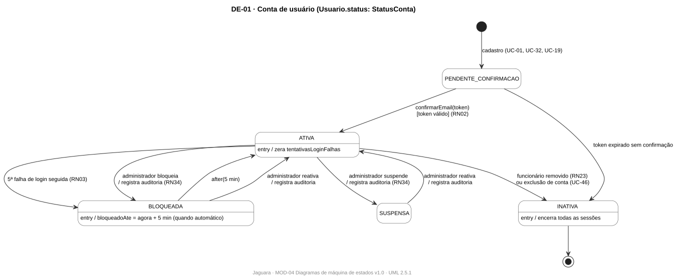
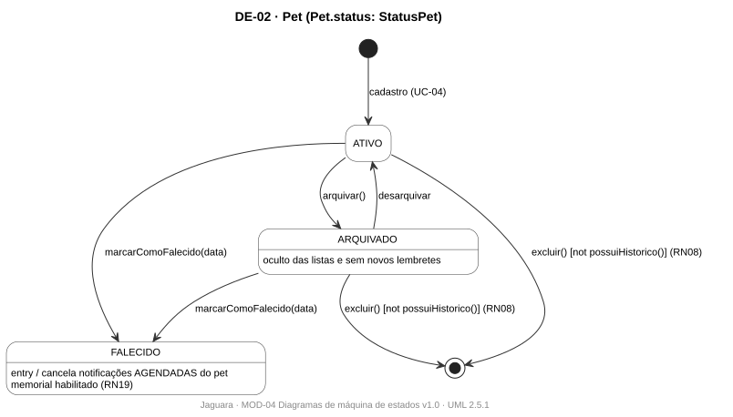
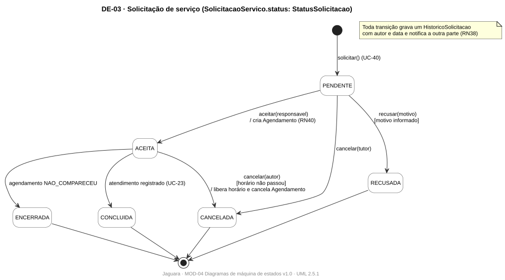
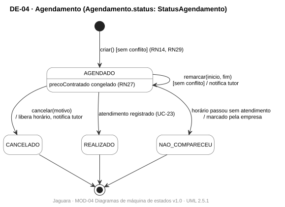
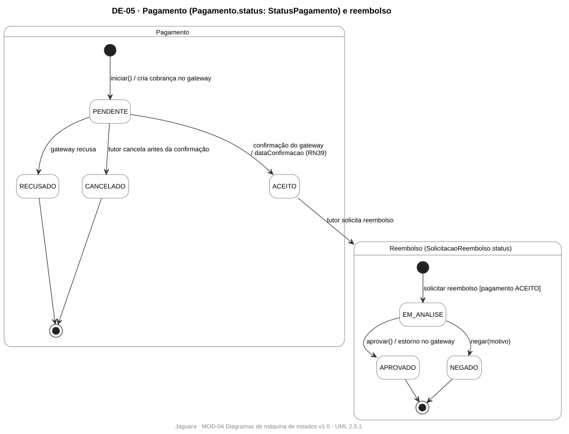
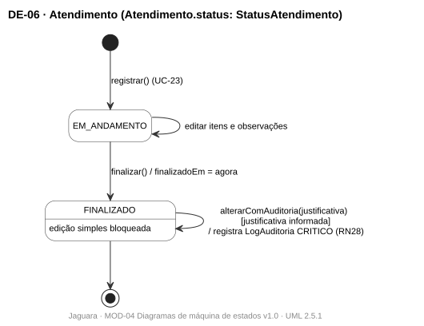

# MOD-04 · Diagramas de máquina de estados

| Campo | Valor |
|---|---|
| Projeto | Jaguara |
| Documento | MOD-04 · Diagramas de máquina de estados |
| Versão | 1.0 |
| Status | Em revisão |
| Autores | Ricardo Guilhen |
| Data | 01/11/2026 |
| Tarefa Jira | JAG-66 |
| Padrão de referência | UML 2.5.1, máquina de estados comportamental |

## Histórico de revisões

| Versão | Data | Autor | Descrição |
|---|---|---|---|
| 1.0 | 01/11/2026 | Ricardo Guilhen | Ciclos de vida de conta, pet, solicitação, agendamento, pagamento e atendimento. |

## 1. Objetivo

Definir as transições permitidas para os objetos que têm ciclo de vida, de modo que o código implemente exatamente essas transições e rejeite as demais. Os estados são os valores das enumerações do [MOD-01](MOD-01-modelo-de-classes.md).

## 2. Convenções

Transição no formato `evento [guarda] / efeito`. Atividades de entrada (`entry /`) dentro do estado. Qualquer transição fora do diagrama é inválida e a API responde `409 Conflict`.

## 3. Diagramas

### 3.1 DE-01 · Conta de usuário

`Usuario.status` (`StatusConta`). Regras RN02, RN03, RN23 e RN34.

### 3.2 DE-02 · Pet

`Pet.status` (`StatusPet`). Exclusão só sem histórico (RN08); memorial só para falecido (RN19).

### 3.3 DE-03 · Solicitação de serviço

`SolicitacaoServico.status` (`StatusSolicitacao`). Toda transição gera histórico (RN38) e o horário só é confirmado com o aceite da empresa (RN40).

### 3.4 DE-04 · Agendamento

`Agendamento.status` (`StatusAgendamento`). Remarcação só sem conflito (RN14, RN29).

### 3.5 DE-05 · Pagamento e reembolso

`Pagamento.status` (`StatusPagamento`, conforme RN39) e `SolicitacaoReembolso.status` (`StatusReembolso`).

### 3.6 DE-06 · Atendimento

`Atendimento.status` (`StatusAtendimento`). Depois de finalizado, só alteração auditada (RN28).

Fontes: [`diagramas-de-estado/`](diagramas-de-estado).

## 4. Tabela de transições

| Objeto | De | Para | Evento | Guarda | Regra |
|---|---|---|---|---|---|
| Usuario | PENDENTE_CONFIRMACAO | ATIVA | confirmarEmail | token válido | RN02 |
| Usuario | ATIVA | BLOQUEADA | 5ª falha de login | — | RN03 |
| Usuario | BLOQUEADA | ATIVA | 5 minutos ou reativação | — | RN03, RN34 |
| Usuario | ATIVA | SUSPENSA | suspensão pelo administrador | — | RN34 |
| Usuario | ATIVA | INATIVA | remoção de funcionário ou exclusão de conta | — | RN23 |
| Pet | ATIVO, ARQUIVADO | removido | excluir | sem histórico | RN08 |
| Pet | ATIVO, ARQUIVADO | FALECIDO | marcarComoFalecido | — | RN19 |
| SolicitacaoServico | PENDENTE | ACEITA | aceitar | sem conflito | RN40 |
| SolicitacaoServico | PENDENTE | RECUSADA | recusar | motivo informado | RN38 |
| SolicitacaoServico | PENDENTE, ACEITA | CANCELADA | cancelar | horário não passou | RN38 |
| SolicitacaoServico | ACEITA | CONCLUIDA | atendimento registrado | — | RN38 |
| Agendamento | AGENDADO | CANCELADO, REALIZADO, NAO_COMPARECEU | cancelar, registrar atendimento, horário passou | — | RN29 |
| Pagamento | PENDENTE | ACEITO | confirmação do gateway | — | RN39 |
| Pagamento | PENDENTE | RECUSADO, CANCELADO | recusa do gateway, cancelamento | — | RN39 |
| Atendimento | EM_ANDAMENTO | FINALIZADO | finalizar | — | RN28 |
