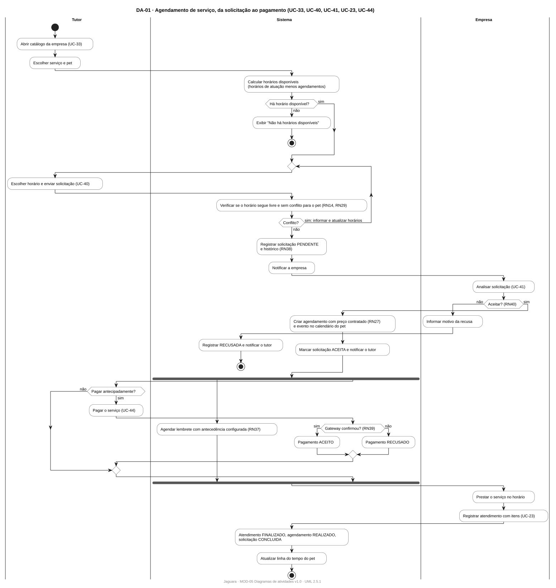
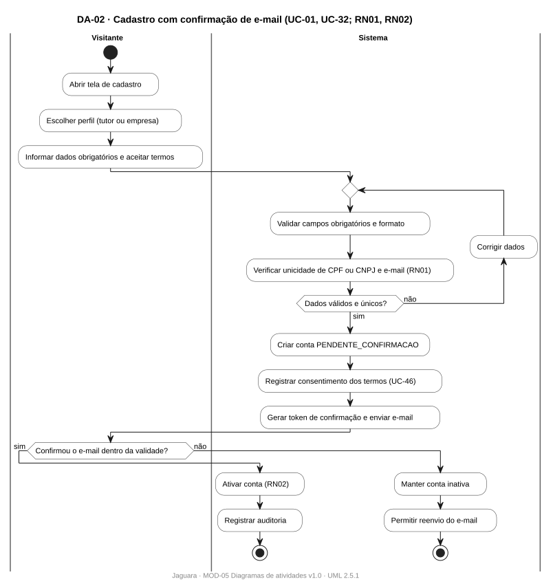
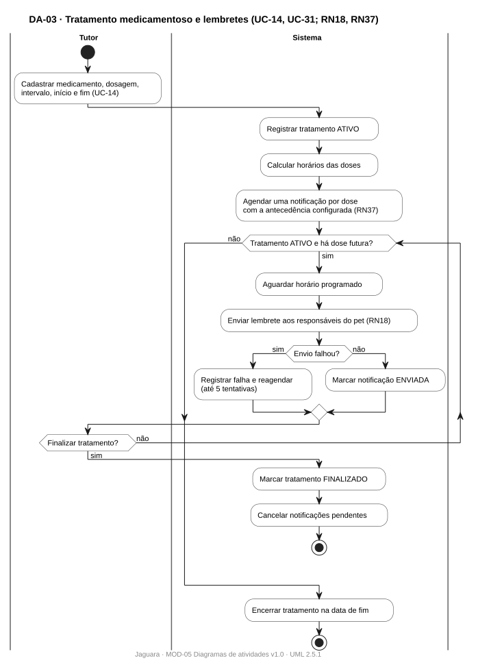

# MOD-05 · Diagramas de atividades

| Campo | Valor |
|---|---|
| Projeto | Jaguara |
| Documento | MOD-05 · Diagramas de atividades dos processos de negócio |
| Versão | 1.0 |
| Status | Em revisão |
| Autores | Ricardo Guilhen |
| Data | 01/11/2026 |
| Tarefa Jira | JAG-67 |
| Padrão de referência | UML 2.5.1, diagrama de atividades com partições (raias) |

## Histórico de revisões

| Versão | Data | Autor | Descrição |
|---|---|---|---|
| 1.0 | 01/11/2026 | Ricardo Guilhen | Processos de agendamento ponta a ponta, cadastro com confirmação e tratamento com lembretes. |

## 1. Objetivo

Mostrar os processos de negócio que atravessam vários casos de uso, com quem faz cada atividade (raias) e os pontos de decisão ligados às regras de negócio.

## 2. Diagramas

### 2.1 DA-01 · Agendamento de serviço, da solicitação ao pagamento

Atravessa UC-33, UC-40, UC-41, UC-23 e UC-44. Raias: tutor, sistema e empresa. É o processo central da integração entre os módulos Tutor e Enterprise.

### 2.2 DA-02 · Cadastro com confirmação de e-mail

UC-01 e UC-32. Validação de unicidade (RN01), consentimento dos termos e ativação pela confirmação do e-mail (RN02).

### 2.3 DA-03 · Tratamento medicamentoso e lembretes

UC-14 e UC-31. Lembretes automáticos enquanto o tratamento estiver ativo (RN18), com antecedência configurável (RN37).

Fontes: [`diagramas-de-atividade/`](diagramas-de-atividade).

## 3. Decisões e regras

| Diagrama | Decisão | Regra |
|---|---|---|
| DA-01 | Horário ainda livre e sem conflito para o pet? | RN14, RN29 |
| DA-01 | Empresa aceita a solicitação? | RN40 |
| DA-01 | Gateway confirmou o pagamento? | RN39 |
| DA-02 | Dados válidos e únicos? | RN01 |
| DA-02 | E-mail confirmado dentro da validade? | RN02 |
| DA-03 | Tratamento ativo e com dose futura? | RN18 |
| DA-03 | Envio do lembrete falhou? | RN37 |
