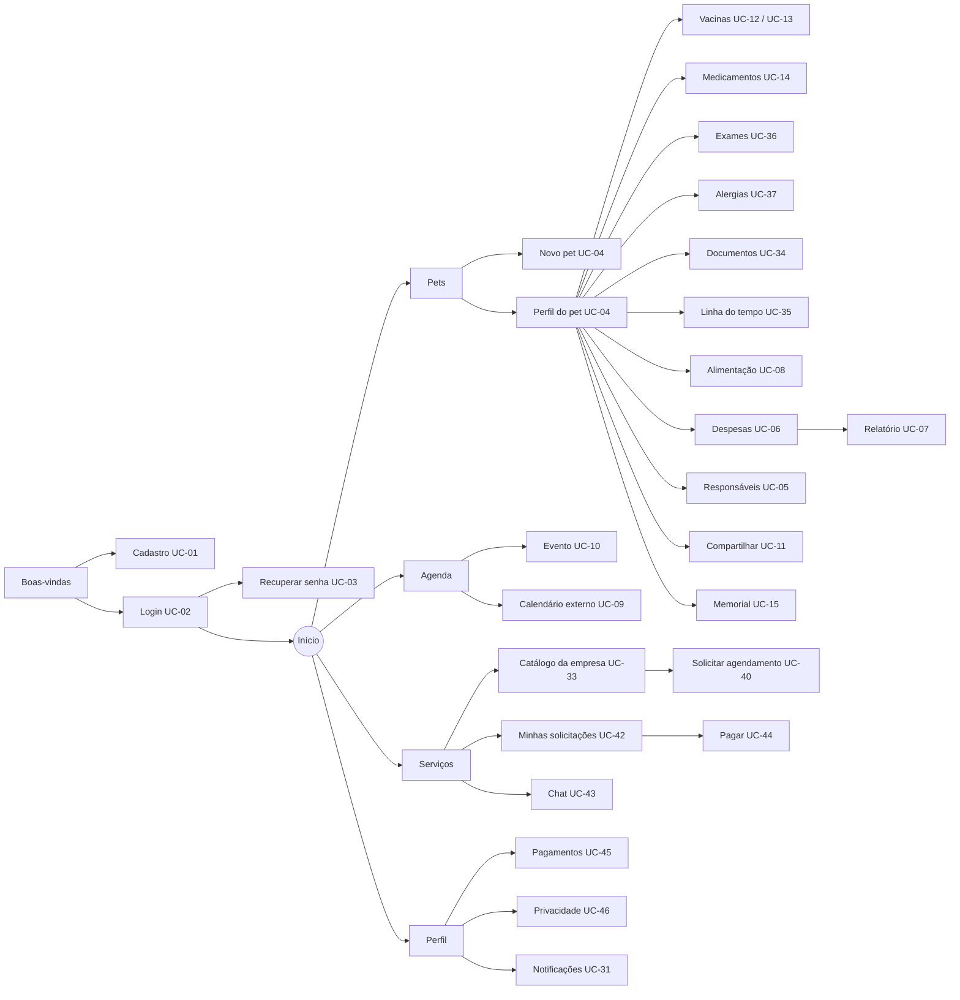
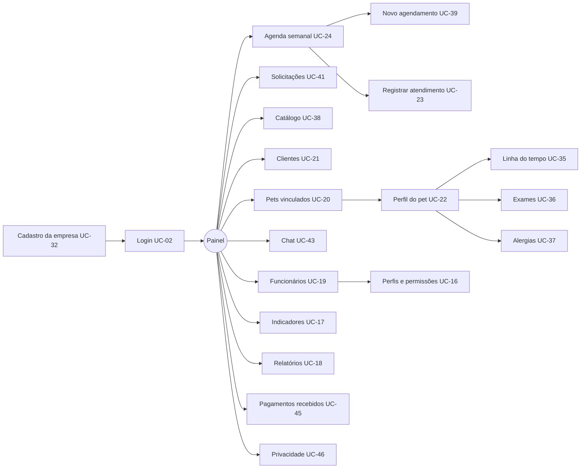
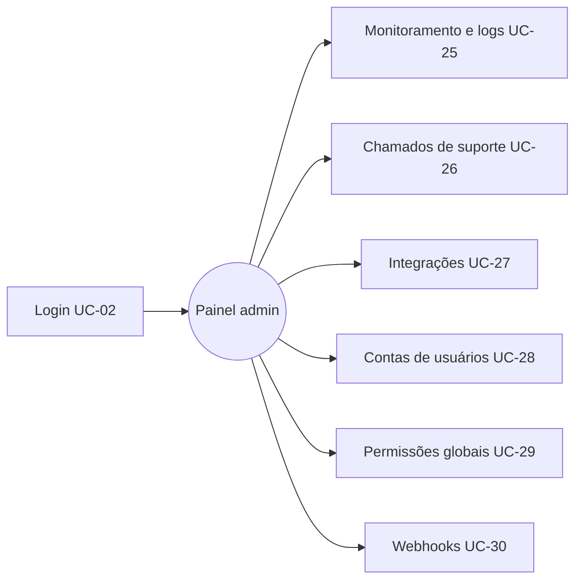

# UX-01 · Mapa de navegação

| Campo | Valor |
|---|---|
| Projeto | Jaguara |
| Documento | UX-01 · Mapa de navegação e fluxos de tela |
| Versão | 1.0 |
| Status | Em revisão |
| Autores | Ricardo Guilhen |
| Data | 01/11/2026 |
| Tarefa Jira | JAG-71 |
| Padrão de referência | Mapa de navegação (sitemap) e fluxos de usuário; WCAG 2.2 |

## Histórico de revisões

| Versão | Data | Autor | Descrição |
|---|---|---|---|
| 1.0 | 01/11/2026 | Ricardo Guilhen | Telas do app do tutor e da web Enterprise e administração, ligadas aos casos de uso. |

## 1. Objetivo

Listar todas as telas da versão 1.0, como se navega entre elas e qual caso de uso cada uma atende. É a base para os protótipos do Figma ([UX-03](UX-03-prototipos.md)).

## 2. Princípios

- Tarefas principais do tutor em até 3 toques a partir da tela inicial (RNF06).
- Navegação por abas no app (Início, Pets, Agenda, Serviços, Perfil) e menu lateral na web.
- Toda tela de dados do pet mostra antes as alergias graves (UC-37).
- Ações destrutivas pedem confirmação; ações sem volta (excluir conta) pedem a senha.

## 3. App do tutor

| Tela | Caso de uso | Toques a partir do Início |
|---|---|---|
| Registrar vacina | UC-13 | 3 (Pets → pet → Vacinas) |
| Registrar medicamento | UC-14 | 3 |
| Criar evento | UC-10 | 2 (Agenda → novo) |
| Solicitar serviço | UC-40 | 3 (Serviços → empresa → serviço) |
| Acompanhar solicitação | UC-42 | 2 |

## 4. Web Enterprise

Funcionários veem apenas os itens liberados pelo seu perfil (RN20).

## 5. Web de administração

## 6. Inventário de telas

| Aplicação | Telas | Casos de uso cobertos |
|---|---|---|
| App do tutor | 31 | UC-01 a UC-15, UC-31, UC-33 a UC-37, UC-40, UC-42 a UC-46 |
| Web Enterprise | 20 | UC-02, UC-16 a UC-24, UC-32, UC-35 a UC-39, UC-41, UC-43, UC-45, UC-46 |
| Web de administração | 7 | UC-02, UC-25 a UC-30 |

Os 46 casos de uso têm pelo menos uma tela.
